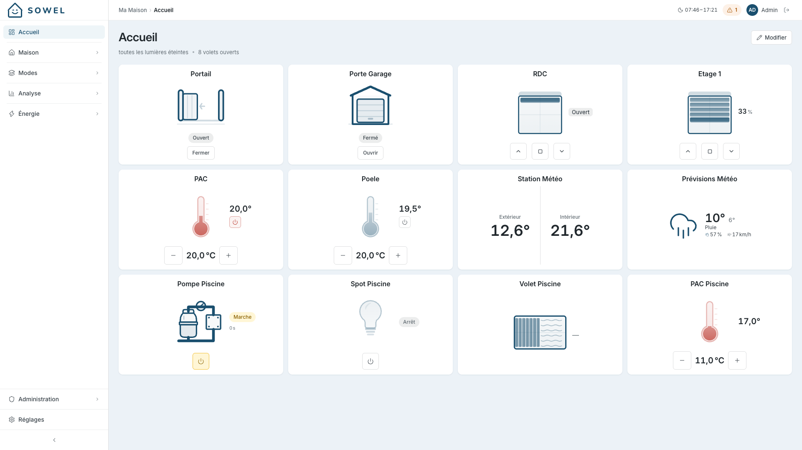
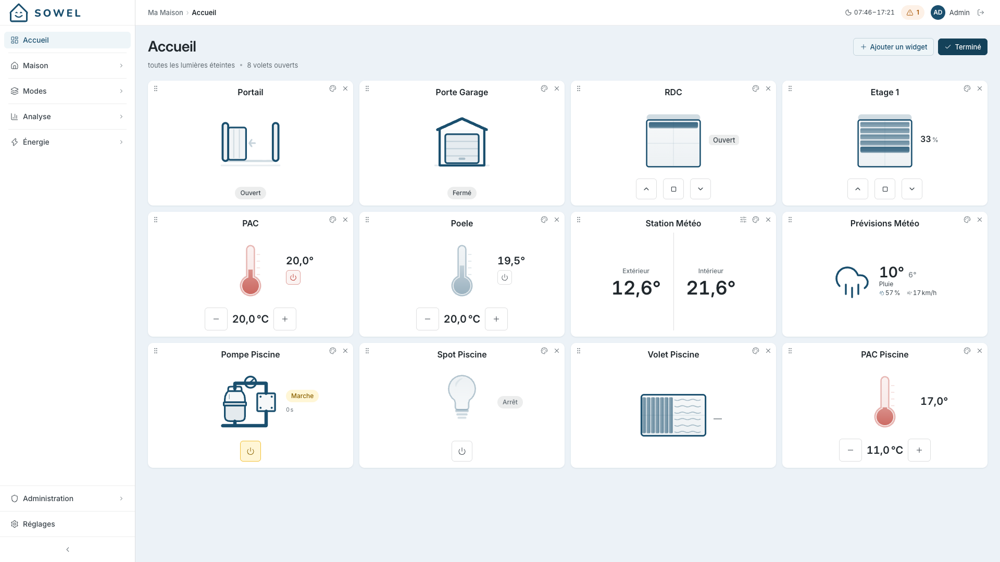

# Accueil

L'Accueil est la page qui s'ouvre au lancement de Sowel, votre écran personnalisé : une grille de widgets configurable qui affiche les informations et les contrôles les plus importants pour vous.

## Vue d'ensemble

Contrairement à la vue Maison (organisée par zones), l'Accueil vous laisse choisir exactement ce que vous voulez voir, peu importe la pièce ou le type d'équipement. Vous pouvez placer les lumières de votre cuisine à côté de la température extérieure et du portail de garage, le tout sur un même écran. Sur ordinateur, une ligne sous le titre résume toute la maison : combien de lumières sont allumées, quels volets sont ouverts.

## Types de widgets

### Widget d'équipement

Affiche un équipement unique avec son état courant et ses contrôles rapides.

- **Lumières** : interrupteur, curseur de luminosité (pour les lumières variables)
- **Volets** : affichage de la position avec contrôles ouvrir/fermer
- **Capteurs** : valeurs actuelles avec icônes et unités appropriées
- **Thermostats** : affichage de température avec indicateur de mode
- **Interrupteurs** : badge d'état on/off

Les équipements on/off (lumières, interrupteurs, prises, chauffe-eau, vannes, radiateurs, pompes de piscine, lecteurs multimédia, portails à action unique) changent d'état quand vous cliquez **n'importe où sur la tuile**, et pas seulement sur le bouton sous l'icône. Les tuiles à plusieurs contrôles -- volets, thermostats, volets de piscine, VMC -- gardent leurs boutons. En mode édition la tuile n'agit plus, pour que vous puissiez la déplacer et la renommer sans risque.

Une tuile qui affiche une **puissance** en watts (prise avec mesure, chauffe-eau, panneau solaire, compteur) ne l'affiche que tant que la mesure est récente. Au-delà, le chiffre laisse place à un tiret et la tuile indique l'âge de la dernière mesure, plutôt que de présenter une valeur que la maison n'a aucune raison de mettre en doute. Le délai suit la cadence réelle de la source : deux minutes pour un compteur qui remonte en continu, dix pour tout le reste, car plusieurs intégrations interrogent leur source toutes les cinq minutes et un appareil en bon état ne doit pas clignoter à chaque interrogation. Les mesures qui partagent un appareil vieillissent ensemble : une tuile solaire retire le courant et la tension avec la puissance, et le panneau de mesures d'une page d'équipement fait de même, car le silence qui a masqué un chiffre les a tous masqués. Un panneau qui s'est simplement arrêté pour la nuit affiche toujours **Veille**, pas une mesure ancienne : il a cessé de produire, il n'a pas cessé de donner de ses nouvelles. C'est la même règle que la décomposition de consommation de la page Énergie.

La tuile **prévisions météo** affiche demain, et indique à quel point les modèles s'accordent sur cette journée : une pastille en pied de tuile (vert fiable, orange assez fiable, rouge peu fiable). Cliquez ou touchez la tuile, sur ordinateur comme sur téléphone, pour ouvrir un panneau qui montre les cinq jours de prévision côte à côte, chacun avec sa condition, son maximum, son minimum, son vent et une pastille de fiabilité, ainsi que le modèle d'où vient la prévision. C'est la même pastille que sur la page de l'équipement.

La fiabilité est publiée par le plugin météo à partir de la version 2.0. Avec un plugin plus ancien, la tuile n'affiche aucune fiabilité et le panneau n'affiche aucune pastille : un jour non qualifié ne doit jamais ressembler à un jour fiable.

Un **pluviomètre** -- un équipement météo qui ne mesure que la pluie, comme un pluviomètre à augets ou un module pluie Netatmo seul -- a sa propre tuile : la pluie tombée aujourd'hui en grand, le cumul sur 24 h glissantes en dessous, et un point qui pulse s'il a plu dans l'heure. Si le pluviomètre ne remonte pas le cumul du jour, la tuile affiche le cumul sur 24 h à la place. Cliquez ou touchez la tuile pour ouvrir un panneau qui reprend la pluie du jour et les 24 h glissantes, ajoute les 7 et 30 derniers jours, le dernier jour de pluie (cherché sur six mois) et 30 barres, une par jour ; survolez ou touchez une barre pour lire le cumul de ce jour-là. Ces chiffres viennent de l'historique du capteur de pluie : un pluviomètre installé depuis peu indique sur combien de jours il a mesuré, et n'affirme jamais « aucune pluie » au-delà de son premier jour de mesure. Une station qui mesure aussi la température, le vent ou l'humidité garde sa tuile habituelle.

#### Portails qui demandent confirmation { #gate-confirmation }

Sur tablette ou ordinateur, une tuile de portail dit ce que fait un clic : un bouton sous l'état indique **Ouvrir**, **Fermer** ou **Actionner** (quand Sowel ne voit pas l'état du portail), et un portail à plusieurs commandes les affiche en toutes lettres — **Ouvrir**, **Fermer**, **Arrêter** — et non sous leur valeur brute.

Quand un administrateur a activé la **Confirmation avant action** sur la page de l'équipement, chaque appui qui ferait bouger le portail demande d'abord. Sur téléphone ou tablette, un panneau s'ouvre avec un curseur à glisser pour confirmer ; à la souris ou au pavé tactile, une boîte de dialogue demande avec **Annuler** et un bouton qui nomme l'action (Entrée confirme, Échap annule). La question dit ce que l'appui va faire : _Fermer Portail ?_ sur un portail ouvert, _Ouvrir Portail ?_ sur un portail fermé, _Actionner Portail ?_ quand l'état est inconnu et, sur un portail à plusieurs commandes, celle sur laquelle vous avez appuyé. Rien n'est envoyé avant la confirmation.

Cela vaut partout où une seule tape ou un seul clic fait bouger le portail : sa tuile de l'Accueil quelle que soit la taille de l'écran et le panneau qu'elle ouvre, la tuile temporisée au lancement (annuler un décompte en cours ne demande rien), la ligne du portail dans la vue Maison, la liste des Équipements et la page de l'équipement. Sur téléphone, un petit bouclier dans le coin de la tuile signale un portail qui demande. Un portail ne demande rien quand un mode est activé, quand l'automatisme d'une recette le fait bouger, quand un invité l'ouvre depuis une page d'accès partagé, ni quand vous appuyez sur le petit bouton de mode d'une tuile de recette.

### Widget de zone

Affiche les données agrégées d'une zone entière. Vous choisissez quelle **famille** de données afficher :

| Famille       | Ce qui est affiché                                                          |
| ------------- | --------------------------------------------------------------------------- |
| **Lumières**  | Nombre de lumières allumées / total, avec une action rapide "tout éteindre" |
| **Volets**    | Nombre de volets ouverts / total, position moyenne                          |
| **Chauffage** | Température moyenne, statut de chauffage                                    |
| **Capteurs**  | Température, humidité, statut de mouvement                                  |

Les widgets de zone vous donnent une vue d'ensemble rapide d'une pièce sans voir les détails de chaque équipement.

### Tuile de recette

Certaines recettes proposent leur propre tuile — un créneau livreur sur un portail, un cycle de filtration, un mode de chauffage. Seules les recettes qui en **déclarent** une apparaissent dans le sélecteur : la plupart des automatisations n'ont rien à montrer d'un coup d'œil et n'en proposent pas.

Ce qu'affiche une tuile de recette est choisi par la recette elle-même, parmi trois éléments :

- une **ligne d'état** : ce que l'automatisation est en train de faire, en une phrase ;
- un **décompte** : le moment où elle agira toute seule, qui descend à la seconde ;
- un ou plusieurs **boutons** qui font défiler les modes de la recette, actionnables directement depuis l'Accueil.

Quand une tuile ne porte qu'**un seul** bouton, inutile de le viser : un clic n'importe où sur la tuile fait la même chose. Une tuile qui en porte deux les garde comme seul point d'entrée — elle ne peut pas deviner lequel des deux vous vouliez. En mode édition, un clic ne déclenche rien.

Une recette qui actionne du physique — un portail, une porte — demande confirmation avant d'agir : sur téléphone ou tablette, une tape sur la tuile ouvre un panneau « glisser pour confirmer » qui annonce ce qu'elle s'apprête à faire, pour qu'une tape dans la poche n'ouvre jamais le portail ; à la souris, un clic sur la tuile ouvre une boîte de dialogue qui pose la même question. Le petit bouton agit toujours tout de suite, quelle que soit la recette.

À cette question, vous répondez **une seule fois, sur l'équipement**. Une recette dont la tuile ouvre votre portail lit la **Confirmation avant action** de ce portail : activez-la là, et la tuile demande confirmation, comme toutes les autres tuiles, lignes et boutons qui font bouger ce portail ([Portails qui demandent confirmation](#gate-confirmation)) ; désactivez-la, et aucun ne le fait. Aucune recette ne peut contredire en douce ce que vous avez décidé pour votre propre portail. Seule une recette qui agit sur plusieurs équipements à la fois — ou sur aucun en particulier — retombe sur un réglage à elle, avec les autres paramètres de l'automatisation.

Une tuile dont l'instance est désactivée s'affiche grisée et garde sa place : une tuile silencieuse n'est jamais un mystère. Si une recette cesse de proposer une tuile après une mise à jour, le widget le dit au lieu de disparaître — supprimez-le vous-même si vous n'en voulez plus.

## Ajouter des widgets

1. Entrez en **mode édition** : sur ordinateur, cliquez sur **Modifier** en haut à droite de l'Accueil ; sur téléphone ou tablette, touchez **Modifier l'accueil** sous la dernière tuile
2. Cliquez sur **Ajouter un widget**
3. Dans la fenêtre, choisissez entre :
   - **Équipement** : parcourez et sélectionnez n'importe quel équipement
   - **Zone** : sélectionnez une zone et une famille de données
   - **Recette** : choisissez l'une des instances de recette qui proposent une tuile

Le widget apparaît à la fin de votre grille.

## Personnaliser les widgets

### Réorganiser

En mode édition, glissez-déposez les widgets pour les réorganiser. L'ordre est enregistré automatiquement.

### Étiquettes et icônes personnalisées

Chaque widget peut avoir une étiquette et une icône personnalisées qui remplacent le nom par défaut de l'équipement ou de la zone. C'est utile pour mettre des noms plus courts sur l'Accueil.

Le sélecteur d'icônes propose d'abord les icônes dessinées qui correspondent au type d'équipement, puis toutes les autres sous **Autres icônes** — une prise qui pilote un compresseur d'air ou une imprimante 3D peut donc porter la machine plutôt qu'une prise.

Une icône choisie suit l'équipement exactement comme celle qu'elle remplace : allumez le compresseur et son dessin s'allume, fermez le portail et le dessin choisi se ferme. Les vignettes du sélecteur sont des aperçus figés — une tuile, elle, montre toujours l'état courant.

### Configuration des widgets de capteur

Pour les widgets d'équipements capteurs, vous pouvez choisir quelles liaisons de données afficher. Par défaut, toutes les liaisons sont affichées. Si un capteur remonte température, humidité et pression mais que seule la température vous intéresse, vous pouvez masquer les autres.

### Supprimer des widgets

En mode édition, cliquez sur le bouton de suppression d'un widget pour le retirer de l'Accueil.

## Mode édition

Le mode édition est réservé aux administrateurs. Sur ordinateur, il se bascule avec le bouton **Modifier** de l'en-tête de l'Accueil. Sur téléphone ou tablette, le bouton **Modifier l'accueil** se trouve sous la dernière tuile, à l'écart des tuiles dont vous vous servez chaque jour. Quand il est actif :

- Un bouton **Ajouter un widget** apparaît : dans l'en-tête sur ordinateur, dans une barre qui reste en bas de l'écran sur téléphone ou tablette
- Chaque widget affiche un bouton **suppression**
- Les widgets peuvent être **glissés** pour être réordonnés
- Cliquez sur **Terminé** (à côté de **Ajouter un widget**) pour quitter le mode édition ; les changements sont déjà enregistrés

!!! tip
L'Accueil est personnel : chaque utilisateur a sa propre disposition de widgets. Les utilisateurs admin et les utilisateurs réguliers voient chacun leur propre Accueil.

## Astuces

- **Restez concentré** : l'Accueil fonctionne mieux avec 6 à 12 widgets. Trop de widgets réduisent la valeur d'un coup d'œil.
- **Utilisez les widgets de zone pour l'aperçu** : un widget "Capteurs" de zone pour chaque étage vous donne la température de toute la maison en un coup d'œil.
- **Utilisez les widgets d'équipement pour le contrôle** : mettez les lumières et volets que vous utilisez le plus sur l'Accueil pour un accès en un seul geste.
- **Adapté au mobile** : sur mobile, les widgets s'empilent en une seule colonne. Placez vos widgets les plus importants en haut.
