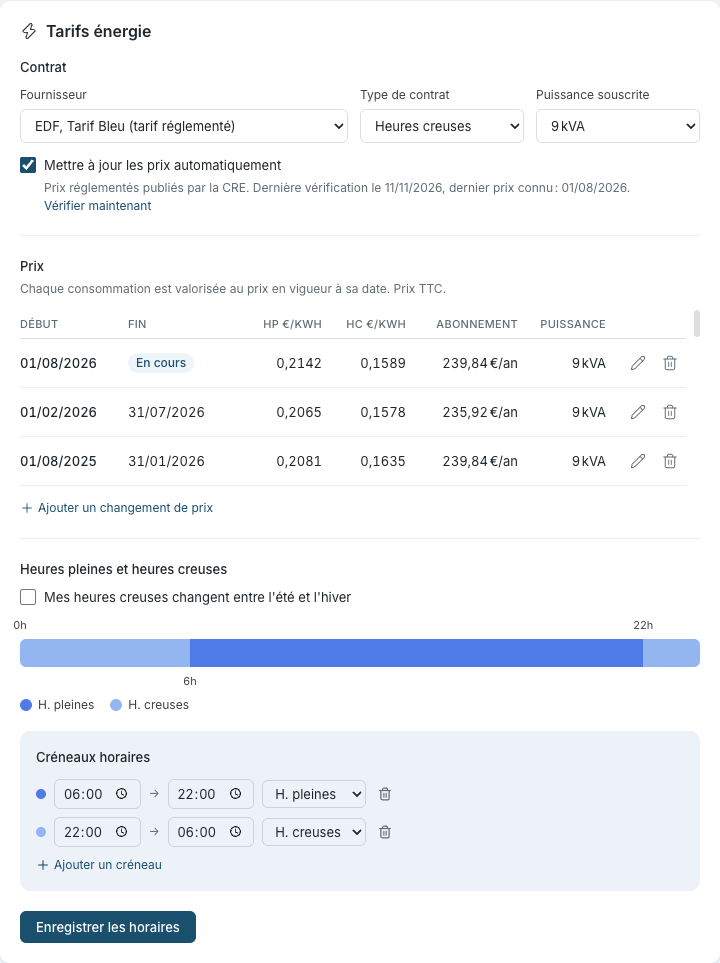

# Suivi énergétique

Sowel intègre un suivi énergétique qui mesure la consommation électrique de votre maison et (en option) votre production solaire dans le temps. Il prend en charge la classification tarifaire heures pleines / heures creuses, le suivi de l'autoconsommation, et un découpage par usage lorsque vous instrumentez des circuits dédiés.

## Les trois types d'équipement énergie

Le suivi énergétique de Sowel est **indépendant de l'intégration**. N'importe quel plugin qui remonte des données d'énergie ou de puissance peut alimenter le pipeline, du moment que le device est lié à l'un des trois types d'équipement ci-dessous.

| Type d'équipement         | Ce qu'il représente                                                     | Données device requises                                        |
| ------------------------- | ----------------------------------------------------------------------- | -------------------------------------------------------------- |
| `main_energy_meter`       | Votre compteur principal (import / export réseau pour toute la maison)  | Énergie cumulée (Wh), ou delta d'énergie réseau signé par tick |
| `energy_meter`            | Un sous-compteur sur un circuit dédié (PAC, piscine, recharge VE, etc.) | Énergie cumulée (Wh) **ou** puissance instantanée (W)          |
| `energy_production_meter` | Votre compteur de production solaire (ou autre production locale)       | Énergie de production cumulée (Wh)                             |

Vous pouvez mixer : une installation avec uniquement un compteur principal fonctionne, vous n'avez pas besoin de solaire pour utiliser la page Énergie. Inversement, vous pouvez avoir plusieurs sous-compteurs sans compteur principal, vous perdrez juste la barre "Autre" sur la vue par usage.

!!! info "Sous-compteurs en puissance seule"
Les pinces zigbee bon marché qui ne remontent que `power` (W) et pas `energy` (Wh) sont supportées en sous-compteur. Sowel intègre localement le signal de puissance en un flux Wh attribué à l'équipement sous-compteur, à la même cadence par minute que le compteur principal. L'état survit aux redémarrages.

## Comment les données circulent

```
Device compteur d'énergie (toute intégration)
  -> Le plugin remonte `energy` (Wh) ou `power` (W)
    -> HistoryWriter écrit des points minute par minute dans InfluxDB
      -> EnergyAggregator calcule les cumuls heure / jour / mois / année
        -> La page Énergie affiche graphiques et totaux
```

InfluxDB stocke les points bruts dans un bucket à rétention courte, puis des tâches de downsampling automatiques agrègent en buckets horaire et journalier avec des rétentions bien plus longues. La page Énergie choisit le bon bucket de manière transparente selon la fenêtre temporelle affichée.

!!! info "InfluxDB est automatique"
InfluxDB est obligatoire et démarre avec Sowel via Docker Compose. Au premier lancement, Sowel crée automatiquement les buckets requis, les tâches de downsampling et les tâches d'agrégation énergétique. Aucune configuration manuelle d'InfluxDB n'est nécessaire.

## Configurer le suivi énergétique

### Étape 1 : connecter une intégration énergie

Installez un plugin qui fournit des devices de compteur d'énergie (parcourez le catalogue depuis **Administration > Plugins**) et configurez-le depuis **Administration > Intégrations**. Tout plugin qui expose un device avec des données `energy` ou `power` convient.

### Étape 2 : créer le compteur d'énergie principal

Allez dans **Administration > Équipements** et créez un équipement :

- **Type** : Compteur d'énergie principal
- **Zone** : typiquement la racine Maison, ou une zone Local technique
- **Liez** à la donnée `energy` du device de votre compteur réseau

Une fois lié, Sowel commence à écrire un point d'énergie par minute dans InfluxDB.

### Étape 3 : (facultatif) ajouter un compteur de production

Si vous avez une production locale (panneaux solaires en général), créez un équipement de type **Compteur de production d'énergie** et liez-le au device de votre compteur de production. Avec un compteur principal et un compteur de production en place, Sowel calcule :

- **Consommation réseau** : énergie tirée du réseau
- **Autoconsommation** : énergie produite et consommée à la maison
- **Injection réseau** : énergie produite renvoyée vers le réseau
- **Consommation totale** : réseau + autoconsommation

### Étape 4 : (facultatif) configurer votre contrat, vos prix et vos heures creuses

Allez dans **Réglages > Énergie**, carte **Tarifs énergie** :



1. **Contrat.** Choisissez votre fournisseur, le type de contrat (heures creuses, ou Base) et votre puissance souscrite. Ils décrivent votre contrat ; ils ne valorisent rien par eux-mêmes. Avec **EDF, Tarif Bleu**, cochez **Mettre à jour les prix automatiquement** : Sowel lit alors, une fois par jour, les prix publiés par la CRE pour votre type de contrat et votre puissance, et la ligne sous la case indique la date de la dernière vérification et le dernier prix connu. **Vérifier maintenant** les lit tout de suite.
2. **Prix.** Les prix sont un historique : chaque ligne vaut de sa date de début jusqu'à la veille de la suivante, et chaque consommation est valorisée au prix en vigueur à sa date. Un changement de prix ne revalorise donc jamais le passé.
   - **Ajouter un changement de prix** quand vos prix changent : saisissez la date de début, les prix HP et HC par kWh TTC, et si vous le souhaitez l'abonnement annuel et la puissance. Vous pouvez le saisir à l'avance, ou en retard : les jours déjà mesurés sont alors revalorisés à partir de cette date.
   - Le crayon corrige une ligne ; la corbeille la supprime. La ligne la plus ancienne, **Origine**, couvre tout ce qui précède le premier changement daté : elle se corrige, elle ne se supprime pas.
   - La liste montre les trois derniers prix et défile pour les plus anciens.
   - **Prix trouvés pour votre contrat.** Avec la mise à jour automatique, une nouvelle période (chaque février et chaque août) s'ajoute toute seule, à sa vraie date de début, et vous êtes notifié. Tout le reste vous attend dans un encadré au-dessus de la liste : les prix passés la première fois (après une mise à jour, ou quand vous réglez votre contrat), un prix publié en retard qui commence avant un changement saisi par vous, et un écart de 30 % ou plus. **Ajouter ces prix** les ajoute ; **Ignorer** les met de côté, et ils ne sont plus proposés sauf si vous le demandez (**Les proposer de nouveau**) ou si vous changez de contrat. Vérifiez d'abord votre puissance souscrite : elle fixe l'abonnement de chaque ligne.
   - La mise à jour automatique ne modifie jamais une ligne existante. Si vous prenez l'historique pour une puissance puis changez de puissance, les dates sont déjà prises et rien n'est proposé : corrigez les abonnements à la main, ou supprimez les lignes et reprenez la liste. Une ligne venue du fichier de prix que vous supprimez est mise de côté : elle ne revient pas le lendemain.
   - Avec un contrat Base, un seul prix est demandé. Les lignes passées qui portent un prix HP et un prix HC gardent les deux.
3. **Heures pleines et heures creuses.** Définissez vos créneaux horaires : quelles heures sont HP et lesquelles sont HC, avec autant de créneaux que nécessaire pour couvrir les 24 h de la journée. **Enregistrer les horaires** n'enregistre que les horaires.
   - Si vos heures creuses ne sont pas les mêmes en été et en hiver (la réforme des heures creuses d'Enedis donne deux plannings à beaucoup de compteurs, avec des heures creuses en début d'après-midi l'été), cochez **Mes heures creuses changent entre l'été et l'hiver**. Deux blocs apparaissent, **Hiver** (du 1er novembre au 31 mars) et **Été** (du 1er avril au 31 octobre), chacun avec sa frise et ses créneaux ; la saison en vigueur aujourd'hui porte **En cours**. La première fois que vous cochez la case, l'été reprend vos créneaux actuels. Décochez-la pour revenir à un seul planning toute l'année.
   - Un changement d'horaires s'applique à partir de son enregistrement : l'énergie déjà enregistrée garde la répartition qu'elle a reçue.

Les prix servent aux vues en euros ; la répartition HP / HC fonctionne sans eux. Sans horaires configurés, toute la consommation est classée en HP par défaut, vous ne voyez juste pas la répartition.

À la mise à jour depuis une version qui n'avait qu'un couple de prix, Sowel les conserve dans la ligne **Origine** : vos chiffres ne bougent pas tant que vous n'ajoutez ou ne corrigez pas un prix.

### Étape 5 : (facultatif) ajouter des sous-compteurs pour une répartition par usage

Pour savoir comment la consommation de votre compteur principal se répartit entre les circuits, ajoutez un équipement `energy_meter` pour chaque circuit instrumenté.

1. Installez une pince zigbee, une prise intelligente ou un compteur Wi-Fi sur le circuit dédié
2. Allez dans **Administration > Équipements** et créez un équipement de type **Compteur d'énergie**
3. Liez-le à la donnée `energy` (Wh) du device, ou — si votre device ne remonte que `power` (W) — à sa donnée `power` : Sowel intègre automatiquement le signal de puissance en flux Wh

Dès qu'un sous-compteur est configuré, le bouton **Par usage** apparaît sur la page Consommation. Le bouton est masqué tant qu'aucun sous-compteur n'existe.

## Utiliser la section Énergie

La barre latérale regroupe les vues énergie sous **Énergie** :

- **En direct** : flux instantané entre réseau, production et consommation maison
- **Bilan** : ce que l'électricité a coûté, ce que le solaire a évité et ce que l'arbitre a rapporté, par jour, mois ou année
- **Consommation** : consommation historique avec répartition HP/HC et autoconsommation
- **Production** : production solaire historique avec répartition autoconsommation / injection

### Vue En direct

La vue En direct affiche ce qui se passe en temps réel — valeurs de puissance mises à jour en continu via WebSocket.


En haut de la carte, une ligne répond à la première question : **Import réseau**, **Export réseau** ou **Autonome**, avec la puissance en grands chiffres et une phrase dessous (« Le soleil couvre 4 % des 5 kW consommés », « La maison consomme 800 W, tout vient du soleil » ou « Pas de production solaire »). Sans compteur de production, ou sans compteur principal, la ligne affiche la consommation seule. Quand une mesure derrière elle est en retard, la phrase se termine par son âge ; le bandeau décrit plus bas dit le reste.

Sous cette ligne, le diagramme montre trois cases (Réseau, Consommation, Production). Le mot **import** ou **export** sous la valeur du réseau dit dans quel sens elle circule (rien à moins de 5 W de l'équilibre). Chaque trajet parcouru par de la puissance est un ruban d'une largeur unique ; une vague de couleur le parcourt, plus vite quand il en passe davantage, et une pointe de flèche à son arrivée donne le sens, même sur un écran figé. Avec le réglage système qui réduit les animations, la vague s'arrête et le ruban prend une couleur plus soutenue ; sa pointe dit encore dans quel sens, et les barres dessous combien. Les parts sont sous les valeurs, plus sur les trajets : une petite barre sous la consommation la répartit entre le réseau et le soleil, avec les deux pourcentages à ses bouts (une seule couleur la nuit ou à l'export), et pendant l'export une barre sous la production la répartit entre la maison et le réseau. Les couleurs sont portées par les icônes et les trajets ; les valeurs sont dans la couleur du texte, pour rester lisibles dans les deux thèmes. Un lecteur d'écran entend tout le flux en une phrase.

Sur un écran large (à partir de 1024 px), le flux et la décomposition de la consommation sont côte à côte, les barres par phase d'un compteur triphasé sous la décomposition ; sur tablette et téléphone, ils s'empilent comme avant. Sur tous les écrans, la légende de la décomposition se place sous l'anneau, centrée dans sa carte. La décomposition ne liste que les charges qui consomment, de la plus forte à la plus faible. Celles à 0 W sont nommées ensemble sur une ligne dessous (« À l'arrêt : Piscine, Congélateur »), et **Autre**, la consommation qu'aucun sous-compteur ne mesure, vient en dernier, marquée « non mesuré ». Une charge dont la mesure est en retard ou hors ligne garde sa propre ligne et le dit.

Les cases sont masquées quand l'équipement correspondant n'est pas configuré : sans compteur de production, seules Réseau et Consommation sont affichées.

Un bandeau apparaît au-dessus du diagramme quand une mesure ne peut plus être crue, une ligne par
source et chacune avec son propre âge. Il dit l'une de ces trois choses :

- **« aucune mesure reçue depuis 12 min »** : plus rien n'arrive de ce compteur. La fenêtre est de
  dix minutes, soit le double de la cadence la plus lente parmi les sources supportées, si bien
  qu'un compteur interrogé toutes les cinq minutes ne déclenche jamais ce bandeau tant qu'il
  fonctionne.
- **« mesure figée sur la même valeur depuis 3 h »** : les mesures continuent d'arriver, mais la
  valeur qu'elles portent a cessé de bouger. C'est une source qui parle encore sans mesurer, et
  aucun horodatage ne peut le révéler. Sowel compare la valeur telle qu'elle est stockée, en pleine
  précision, jamais le chiffre arrondi dessiné sur le diagramme : une production affichée à 2,4 kW
  peut varier de 49 W sans que l'affichage ne bouge. Deux cas sont laissés tranquilles : une mesure
  exactement nulle, qu'un compteur de production tient réellement toute la nuit, et tout ce qui dure
  moins d'une heure, pour qu'un onduleur assis sur son plateau d'écrêtage un midi clair ne dise
  rien.
- **« plus de connexion depuis 20 min »** : l'appareil du compteur a quitté le réseau.

Seules les mesures de puissance dessinées par le diagramme sont surveillées : un compteur simplement
en retard sur une tension ou un index d'énergie ne déclenche rien ici.

### Vue Bilan

La page Bilan répond en euros, pour un **Jour**, un **Mois** ou une **Année** (les flèches changent de date, et la période et la date sont les mêmes que sur la page Consommation). Elle a besoin d'un tarif : sans tarif, elle invite à le renseigner dans **Réglages > Tarif**.

- **La facture.** Le grand chiffre est ce que le réseau a coûté sur la période, réparti entre heures pleines et heures creuses. C'est le même total que la vue € de la page Consommation. En dessous, une comparaison : pour un jour, la moyenne des 7 jours précédents ; pour le mois en cours, ce que coûtera le mois à ce rythme, et le même mois un an plus tôt ; pour une année, les mois qui ont des relevés presque tous les jours les deux années (« De mai à octobre : 474 €, contre 939 € en 2025 (−50 %) »).
- **Abonnement.** En vue Mois et Année, quand vos prix portent un abonnement annuel, une ligne sous la facture donne ce qu'il a coûté sur la période (« Abonnement 9 kVA », « Part fixe au prorata, 31 jours »), puis le **Total avec l'abonnement**. Chaque jour compte le montant annuel des prix en vigueur ce jour-là divisé par le nombre de jours de son année, jusqu'à aujourd'hui pour une période en cours. Le grand chiffre reste la consommation, et la comparaison en dessous ne compare que la consommation. Les jours dont les prix n'ont pas d'abonnement sont signalés dans la légende, avec un lien vers **Réglages > Tarif**. La vue Jour n'affiche pas d'abonnement.
- **Électricité consommée, en euros.** Avec un compteur de production, une barre découpe ce que valait l'électricité consommée entre ce que vous avez **payé** au fournisseur et ce que le solaire a **évité** : les kilowattheures solaires consommés sur place, au prix qu'ils auraient coûté à ce moment-là. « Sans panneaux, la facture aurait été de … » est la somme des deux.
- **Économie solaire** et **Gain de l'arbitre.** Deux tuiles reprennent le montant évité avec l'énergie autoconsommée, et donnent la part de l'arbitre (voir [Ce que rapporte l'arbitre](#ce-que-rapporte-larbitre)). La tuile de l'arbitre apparaît lorsque l'arbitre est activé, ou lorsque la période contient un gain mesuré pendant qu'il l'était.
- **Coût par heure, par jour ou par mois.** Des barres empilées : payé en heures pleines, payé en heures creuses, et évité par le solaire au-dessus. En vue Année, un trait pointillé marque la facture de l'année précédente pour le même mois. Quand de nouveaux prix commencent pendant la période, une ligne verticale en pointillé, **Nouveaux prix**, marque le jour (vue Mois) ou le mois (vue Année) où ils commencent.
- **Par usage.** Une ligne par sous-compteur, plus **Autres** : ses kilowattheures, ce qu'il a coûté, ce que le solaire a évité pour lui, triés par montant payé. Chaque heure (vue Jour), chaque jour (vue Mois) ou chaque mois (vue Année), la part solaire de la maison est appliquée à chaque sous-compteur : ces montants sont donc un peu plus précis que les € par usage de la page Consommation, qui valorisent les kilowattheures de chaque sous-compteur en entier, solaire compris.
- **Comment ces montants sont calculés.** La dernière carte (repliée sur un téléphone) donne les prix utilisés et ces règles. Quand les prix ont changé pendant la période, elle le dit et liste chaque partie avec ses prix et son abonnement (« Du 1er février au 31 juillet : heures pleines 0,2065 €/kWh, heures creuses 0,1578 €/kWh, abonnement 235,92 € par an. »). Quand un abonnement est affiché, elle explique comment il est compté.

### Vue Consommation

Choisissez une période (Jour, Sem, Mois, Année) et naviguez avec les flèches. Sur un téléphone, les commandes s'empilent en une colonne alignée à gauche, les onglets de période sur toute la largeur.

La carte s'ouvre sur la réponse : la consommation totale de la période en grand, avec « aujourd'hui », « cette semaine »… à côté (ou la date, pour une période passée), puis une phrase qui la détaille : `9,44 kWh en heures pleines · 1,97 kWh en heures creuses · 3 % autoconsommé`. Le graphique en dessous affiche une barre par seau temporel de la période sélectionnée, avec ses axes et leurs graduations.


Code couleur sur le graphique **Total** :

| Couleur    | Signification                                                |
| ---------- | ------------------------------------------------------------ |
| Bleu foncé | Consommation réseau en heures pleines                        |
| Bleu clair | Consommation réseau en heures creuses                        |
| Vert       | Autoconsommation (uniquement avec un compteur de production) |

La légende sous le graphique a une pastille par couleur, heures pleines et heures creuses comprises, avec les noms seuls : les chiffres sont dans l'en-tête au-dessus. Le thème sombre garde les mêmes significations avec ses propres nuances : les heures pleines restent le bleu vif et les heures creuses le bleu pâle, assez éloignés pour distinguer deux barres empilées. Le survol d'une barre ouvre une infobulle avec les mêmes pastilles ; ses libellés et ses valeurs sont dans la couleur du texte, ce que le bleu pâle ne permettrait pas de lire.

Le total compte tout ce que la maison a consommé, réseau et soleil ; la part autoconsommée est celle du soleil.

#### Bascule Wh / €

Un sélecteur segmenté **Wh / €** est placé à côté du sélecteur de période en haut de la page. En mode **€**, chaque valeur en kWh du graphique (axe Y, hauteur de barre, tooltip) et de l'en-tête est remplacée par le coût correspondant en euros, calculé à partir des prix saisis dans **Réglages > Tarifs énergie**. La bascule est désactivée — avec une tooltip qui renvoie vers les réglages — tant qu'au moins un des prix HP / HC n'est pas non nul.

La valorisation est appliquée au moment de l'affichage, chaque consommation au prix en vigueur à sa date ([historique des prix](#etape-4-facultatif-configurer-votre-contrat-vos-prix-et-vos-heures-creuses)) : un changement de prix s'applique à partir de sa date de début, et corriger un prix passé ne revalorise que la consommation de cette période. Dans les vues mois et année, la première heure ou les deux premières heures de la nuit d'un changement restent valorisées à l'ancien prix. L'autoconsommation n'a pas de coût facturé, elle est donc masquée du graphique en mode € et laissée hors du total en € : l'en-tête donne alors la facture, répartie en heures pleines et heures creuses, la part autoconsommée restant un pourcentage d'énergie.

#### Bascule Total / Par usage

Quand au moins un sous-compteur est configuré, un bouton **Total / Par usage** apparaît à côté de l'en-tête. Lui, la bascule Wh / €, les onglets de période (ici et sur la page Analyse) et les boutons de fenêtre de la prévision sont le même sélecteur segmenté. La vue **Par usage** remplace la répartition HP / HC par une pile par sous-compteur, plus une pile **Autre** pour le résidu vu par le compteur principal mais non comptabilisé par les sous-compteurs. L'en-tête donne alors le total de ces piles, l'énergie réseau mesurée par le compteur principal, sans la phrase heures pleines / heures creuses.


Les sous-compteurs prennent leurs couleurs dans une palette de huit couleurs de séries, dans un ordre fixe (trié par équipement), afin qu'un même circuit garde la même couleur d'un jour à l'autre, d'une vue à l'autre et dans la répartition En direct. La palette n'a ni rouge, ni orange, ni ambre, ni vert solaire, couleurs qui ont un sens ailleurs, et chaque couleur a une variante claire et une variante sombre. La page Analyse utilise la même palette ; un graphique enregistré avec l'ancienne palette affiche la nouvelle couleur à la même position. La pile "Autre" est bornée à zéro, donc un sous-compteur qui dépasserait brièvement le compteur principal (à cause d'un décalage d'échantillonnage) ne peut pas la rendre négative.

En €, chaque sous-compteur est valorisé heure par heure (jour par jour dans les vues semaine et mois, mois par mois dans la vue année), au prix moyen payé par la maison sur cette même heure : une charge qui tourne en heures creuses est valorisée au prix des heures creuses. Les kilowattheures solaires restent comptés au prix du réseau : une borne de recharge qui charge sur le surplus solaire coûte donc moins que ce chiffre. Son coût exact, réparti heures pleines / heures creuses / solaire et par voiture, est sur les fiches de la borne et de la voiture ([recharges](equipments.md#recharges-et-cout-par-voiture)).

##### Quand un compteur en alimente un autre

Les tableaux électriques s'emboîtent : un gîte mesuré par une pince, et son chauffe-eau — alimenté depuis ce même tableau — par une seconde. Les deux sont des sous-compteurs, donc sans rien faire les kilowattheures du chauffe-eau seraient comptés deux fois, une par pile, et le résidu "Autre" en perdrait tout autant.

Dites-le sur le compteur intérieur : ouvrez sa page d'équipement et choisissez, sous **Déjà compté par**, le compteur qui l'alimente. La répartition affiche alors le compteur extérieur **déduction faite de l'intérieur** — le gîte moins son chauffe-eau — tandis que l'intérieur garde sa mesure entière, et les deux piles cessent de se recouvrir. Sa légende indique "déduction faite de ses sous-compteurs", pour distinguer la part affichée de la carte du compteur, qui continue elle d'afficher ce que mesure sa pince.

Les chaînes fonctionnent : avec un tableau qui alimente un gîte qui alimente un chauffe-eau, chaque niveau est affiché déduction faite de celui qui est directement dedans, et les trois s'additionnent toujours pour redonner le tableau.

La même soustraction s'applique à la répartition en direct de cette page, pour que le donut et les barres du jour racontent la même chose.

Deux choses à savoir : supprimer le compteur extérieur efface la déclaration portée par ceux qui sont à l'intérieur, ce qui les fait de nouveau compter deux fois, donc redéclarez leur nouveau parent si le câblage est toujours imbriqué ; et les cartes d'équipement continuent toujours d'afficher ce que chaque pince mesure, une carte qui contredirait son propre capteur étant pire que le recouvrement qu'elle corrige.

##### Quand un compteur est alimenté par un autre réseau

La topologie inverse existe aussi : une pince sur un circuit alimenté par **un autre compteur du fournisseur** — une prise de recharge VE sur un second abonnement, par exemple. Ses kilowattheures ne passent jamais par votre compteur principal : les compter dans la répartition invente une consommation que le principal n'a jamais vue, écrase le résidu "Autre" jusqu'à zéro, et facture au tarif principal l'énergie d'un autre réseau.

Dites-le sur le compteur : ouvrez sa page d'équipement et cochez **Alimenté par un autre compteur**. Le compteur sort alors de la répartition par usage et du donut en direct, et s'affiche **à part** — son propre groupe sous chacun des deux, en kWh seulement, jamais en € (Sowel ne connaît pas le tarif de l'autre réseau). Sa carte, son historique et ses graphiques ne changent pas : la mesure est aussi réelle qu'une autre, elle appartient juste à un autre bilan.

Un compteur sur alimentation séparée ne peut pas être choisi sous **Déjà compté par** — rien de ce que la répartition affiche ne peut être « dans » un compteur d'un autre réseau.

##### Quand un panneau solaire est raccordé derrière un sous-compteur

Un petit panneau peut être raccordé derrière un sous-compteur plutôt que via le compteur de production : quelques modules sur le toit du local piscine, derrière la pince de la piscine. Quand le panneau produit plus que le circuit ne consomme, la pince lit une puissance **négative**. Par défaut, Sowel prend une valeur négative pour une pince montée à l'envers et en compte la valeur absolue comme consommation : la production du panneau gonflerait la part du circuit, réduirait d'autant "Autre", et n'apparaîtrait jamais comme production.

Dites-le sur le compteur : ouvrez sa page d'équipement et cochez **Une production locale passe par ce compteur**. À partir de là :

- la part du circuit garde la partie positive de sa mesure. La pince mesure le circuit **net du panneau** : tant que le panneau couvre une partie de la consommation de la pompe, cette part n'apparaît ni en consommation ni en production ;
- la partie négative compte comme **production solaire** de la maison : elle s'ajoute à la production totale, à l'autoconsommation et à la consommation de la maison qui en est déduite ;
- sur la page en direct, la ligne du circuit n'affiche que sa consommation et la production du panneau rejoint le flux solaire.

Cela fonctionne que le circuit consomme ou produise à un instant donné : chaque intervalle entre deux mesures est découpé au point où la puissance passe par zéro. Cela s'applique à partir du moment où la case est cochée — l'historique n'est pas réécrit ; la décocher plus tard garde ce qui a déjà été compté. Il faut qu'un équipement **Compteur d'Énergie (production)** soit configuré, puisque c'est là que l'autoconsommation est enregistrée.

La case n'est proposée que sur un compteur qui remonte une puissance seule (Sowel en calcule l'énergie) : un compteur doté de son propre index d'énergie ne peut pas être découpé par le signe. Ce n'est pas combinable avec **Alimenté par un autre compteur** : la production de ce panneau n'atteint jamais votre compteur principal. Si le compteur est déclaré dans un autre (**Déjà compté par**), la pince englobante voit aussi le panneau et n'est pas découpée : cochez la case sur le compteur le plus interne, celui qui porte seul le panneau.

Les totaux (HP / HC, autoconsommation) restent identiques entre les deux modes.

#### Périodes plus longues

Passer en **Mois** ou **Année** garde les mêmes couleurs et totaux, mais chaque barre représente un jour (vue Mois) ou un mois (vue Année).


### Vue Production

La page Production regroupe tout ce qui concerne vos panneaux. Sa carte s'ouvre sur l'énergie produite sur la période ; sur la vue Jour d'aujourd'hui, elle se lit face à la prévision, `0,39 kWh sur 7,93 kWh attendus aujourd'hui`, et la phrase en dessous la répartit entre autoconsommation (produite et consommée sur place) et injection réseau. Le graphique en dessous garde ses axes. Sur la vue Jour d'aujourd'hui, son échelle monte au moins jusqu'à l'heure la plus productive de la prévision : les premières barres du matin s'inscrivent dans le cadre de la journée annoncée au lieu de remplir un cadre d'un demi-kilowattheure.

Depuis la v1.57.0 elle porte aussi deux panneaux, tous deux nourris par votre propre installation plutôt que par un modèle générique :

- **Prévision**, une courbe horaire de production attendue jusqu'à cinq jours (« Attendu » en pointillé gris, la production mesurée « Réalisé » en trait plein vert, le vert des barres au-dessus), apprise sur votre historique. Elle réclame le plugin `weather-forecast` en 2.3.0 ou plus, et environ six semaines de production avant que le modèle ne se stabilise. En attendant, Sowel affiche une estimation ciel clair provisoire et le dit.
- **Santé**, qui signale quand les panneaux cessent de produire ce que votre propre historique laisse attendre. Déclarer un nouveau pan de toiture, ou changer la puissance crête, ré-estime le gain sur les jours qui suivent au lieu d'attendre que la fenêtre glisse.

Les deux sont détaillés dans [Suivre sa production solaire](../deep-dives/pv-health.md).

**Lire la justesse.** Sous les deux totaux journaliers, le panneau de prévision indique de combien il s'est trompé : `± 1,15 kWh (5,2 %) sur 9 jours complets, prévus la veille`. C'est l'erreur sur l'**énergie d'une journée**, moyennée sur les jours terminés de la fenêtre, et le pourcentage rapporte cette erreur à ce que ces jours ont réellement produit. Seuls les jours complets comptent : une journée que le compteur n'a pas couverte de bout en bout est écartée plutôt que mise sur le dos du modèle.

Le jour en cours a sa propre ligne, `Aujourd'hui à cette heure`, qui compare ce qui avait été prévu la veille pour les heures déjà écoulées à ce qui a été mesuré sur ces mêmes heures. Elle répond à « est-ce que la journée est dans les clous », ce que la moyenne sur plusieurs jours ne peut pas dire.

Avant la v1.68.0, ce chiffre était une moyenne d'erreurs de puissance horaire, en watts. La moitié environ d'une fenêtre est de la nuit, où rien n'est attendu et rien n'est produit : ces heures parfaites divisaient le nombre par deux, et il s'améliorait tout seul chaque automne à mesure que les nuits s'allongeaient. Un total d'énergie ne peut pas être dilué ainsi.

Les boutons au-dessus du graphe choisissent la profondeur d'historique affichée : un jour, trois jours, une semaine, un mois ou trois mois. Ils ne zooment que la courbe. La justesse, elle, regarde toujours au moins une semaine en arrière : zoomer sur une seule journée ne la prive donc pas des jours terminés dont elle a besoin.

## Arbitrage du surplus

Quand vous produisez du solaire, plusieurs automatisations peuvent vouloir le même surplus au même moment (pré-refroidir la maison, faire tourner la pompe de piscine, chauffer l'eau). Sans coordination elles se le disputent : chacune s'allume en voyant de l'injection, ensemble elles dépassent, l'injection s'effondre, et tout s'éteint. L'**arbitre de surplus** est l'arbitre unique qui distribue le surplus dans l'ordre que **vous** décidez.

Il est **désactivé par défaut** et ne change rien tant que vous ne l'activez pas. Sur une maison sans production solaire, il reste masqué.

### Déclarer une charge pilotable

Sur un équipement dont le type est une charge pilotable (pompe de piscine, chauffe-eau, vanne d'eau, VMC, borne de recharge, radiateur ou thermostat), ouvrez sa fiche et activez **Pilotage énergie**. Vous réglez :

- **Puissance nominale** — pré-remplie depuis la mesure de l'équipement quand une pince est associée.
- **Import toléré (W)** — combien d'import réseau cette charge accepte pour démarrer sur un **surplus partiel**. L'arbitre l'engage dès que le surplus couvre « puissance nominale + marge − import toléré ». À `0` (défaut), elle n'attend qu'un surplus complet ; monter cette valeur la fait démarrer plus tôt, en acceptant d'acheter un peu de réseau. C'est le curseur confort / économie de la charge, réglé une fois ici et respecté par toute automatisation qui la pilote.
- **Marche / arrêt minimum** — durée minimale de marche une fois démarré, et de repos avant redémarrage (protège un compresseur des cycles courts).

La façon dont l'arbitre traite la charge est **dérivée de son type**, il n'y a donc rien à choisir :

- un **relais** dont marche/arrêt est une commande (pompe de piscine, chauffe-eau, borne de recharge) peut être coupé et relancé plus tard sur le surplus, et un on/off inattendu est lu comme une reprise en main manuelle ;
- une charge **auto-régulée** (un thermostat ou une climatisation) voit son fonctionnement normal seulement complété par le surplus, et l'arbitre n'interprète pas ses propres cycles marche/arrêt comme une action de votre part.

Un type d'équipement sans comportement énergétique (une simple lumière ou un interrupteur générique) ne peut pas être déclaré charge pilotable.

Activer ceci ne fait que _déclarer_ la charge. Rien ne la pilote tant que l'arbitre lui-même n'est pas activé.

### Activer l'arbitre et définir la priorité

Allez dans **Réglages > Administration > Énergie**, activez l'**Arbitre de surplus**, et ordonnez vos charges pilotables dans la liste de priorité. La liste se lit dans les deux sens : le surplus est offert de haut en bas, et quand il manque, la charge du bas s'efface la première. Les seuils de temporisation avancés sont derrière un repli, avec des valeurs par défaut raisonnables.

### La lire sur la page En direct

La page **Énergie > En direct** gagne un panneau d'arbitrage du surplus en trois parties :

- un **tableau** listant chaque charge pilotable dans votre ordre de priorité, avec son état et ses chiffres ;
- un **historique** des dernières heures : le surplus et le déficit en courbe, puis un couloir par charge pilotable ;
- un **journal des décisions** en langage clair, pour que rien de ce que fait l'arbitre ne soit un mystère.

La pastille à côté du titre dit où en est la maison : _Surplus 1,2 kW_ sur une teinte verte quand elle exporte, _Déficit 4,8 kW_ sur le bleu ardoise du réseau quand elle importe. Un déficit est l'état normal d'un matin ou d'un soir, pas une panne, donc rien ne passe au rouge ; le rouge est réservé à une charge dont le surplus a été retiré. Tant que la maison importe, une ligne sous le titre dit _Aucune charge ne peut démarrer tant que la maison importe._

Le tableau répond aux deux questions que vous vous posez vraiment devant lui : qui a le surplus, et qu'est-ce qui retient la suivante. Survolez un en-tête de colonne pour sa définition en une phrase.

| Colonne            | Ce qu'elle dit                                                                                                                                                                                                                                                                                                                                                                                                                                                  |
| ------------------ | --------------------------------------------------------------------------------------------------------------------------------------------------------------------------------------------------------------------------------------------------------------------------------------------------------------------------------------------------------------------------------------------------------------------------------------------------------------- |
| **Il manque**      | Ce qui manque encore à une charge en attente, en watts. Tant que la maison importe, une charge en attente affiche _déficit_ à la place : il leur manque à toutes le déficit entier, et le chiffre revient avec le surplus. Quand rien ne manque, elle le dit avec un mot : _couvert_ pour une charge qui a déjà le surplus, _non demandé_ pour une charge qu'aucune automatisation n'a réclamée, ou la raison qui la retient (temporisation, anti-cycle court). |
| **Puissance**      | Ce que la charge consomme : mesuré quand elle tourne, sa puissance nominale au repos.                                                                                                                                                                                                                                                                                                                                                                           |
| **Import toléré**  | L'import réseau qu'elle accepte, tel que réglé dans sa gestion d'énergie.                                                                                                                                                                                                                                                                                                                                                                                       |
| **Surplus requis** | Le surplus qu'il faut pour la démarrer : **puissance + marge d'engagement − import toléré**. L'infobulle de l'en-tête de colonne donne la marge, vous pouvez donc vérifier le calcul sur n'importe quelle ligne. Une charge qui tolère plus d'import qu'elle ne consomme n'a besoin d'aucun surplus et affiche 0 W.                                                                                                                                             |

Le numéro devant chaque nom est son rang dans votre liste de priorité, comme le dit l'infobulle de l'en-tête _Équipement_. Sur un écran étroit, le tableau garde l'équipement, son état et ce qu'il lui manque, et laisse tomber le reste. _Prochaine bascule_ nomme la première charge en attente et le surplus dès lequel elle démarrera (_Démarrera dès 600 W de surplus_).

La nuit, l'arbitre se met en veille : il n'y a pas de surplus à distribuer, chaque charge est _au repos_, et le panneau indique la reprise.

#### L'historique

La courbe est à l'échelle : le zéro se place là où le mettent les pics de la fenêtre, un watt a la même hauteur au-dessus et au-dessous de la ligne, et chaque moitié porte ce que vaut son bord (_+0,3 kW_ en haut, _4,8 kW import_ en bas). Sur la fenêtre en direct, la courbe va jusqu'à maintenant et finit sur un point qui porte le chiffre actuel, celui de la pastille.

Chaque couloir dessine une suite de quarts d'heure dans le même état comme une seule barre : une nuit au repos se lit comme une longue barre pâle plutôt que quarante cases. La légende ne liste que les états présents dans la fenêtre, plus _Au repos_. Une charge en attente de surplus pendant que l'arbitre était en veille (soleil couché, rien d'exporté) se lit _au repos_ sur ces quarts d'heure aussi, comme le tableau la montrait à ce moment-là : elle n'attendait rien qui pouvait venir avant le lever du soleil.

Pointez l'historique à la souris pour lire un quart d'heure : son heure, l'import ou le surplus, et ce que faisait chaque charge. Sur un téléphone, touchez un quart d'heure pour faire remonter ses décisions dans le journal. Au clavier, chaque couloir est un seul arrêt de tabulation : les flèches gauche et droite passent d'un quart d'heure à l'autre, Entrée les montre dans le journal. Les flèches au-dessus de la courbe remontent les 48 dernières heures, 6 heures à la fois sur un téléphone et 12 heures dès une tablette.

### Ce que rapporte l'arbitre

Chaque minute, Sowel note l'énergie solaire consommée par les charges que l'arbitre a lancées, et si cette minute était en heures pleines ou en heures creuses. Sa valeur en euros est calculée à l'affichage, aux prix en vigueur ce jour-là. Les charges sont servies **en dernier** par le soleil : quand la maison importe, l'import leur est attribué d'abord, si bien que le chiffre ne revendique jamais le solaire que la maison a consommé elle-même. Le résultat s'accumule par jour et par charge et s'affiche sur la page Bilan, dans la tuile **Gain de l'arbitre**, avec les deux charges qui ont rapporté le plus. Il fait partie de l'économie solaire, il ne s'y ajoute pas. Une charge est comptée à sa puissance mesurée quand elle a son propre compteur ; sans compteur, à sa puissance apprise ou déclarée tant qu'elle est autorisée, si bien qu'une charge qui s'arrête d'elle-même (un chauffe-eau dont le thermostat coupe) est surestimée jusqu'à ce qu'elle soit libérée.

La mesure commence le jour où la version qui l'apporte est installée : les périodes antérieures affichent « Pas encore mesuré ».

### Vous avez toujours le dernier mot

Si vous allumez ou éteignez vous-même une charge pilotable — dans l'application, avec un bouton physique, ou l'interrupteur mural — l'arbitre s'efface et la laisse tranquille pendant deux heures. Sa fiche d'équipement affiche _Manuel jusqu'à HH:MM_ avec un bouton **reprendre le pilotage** si vous voulez la lui rendre plus tôt.

## Pipeline de données

Comprendre comment circulent les données aide au diagnostic :

```
Le plugin remonte energy ou power
  -> Points minute par minute écrits dans le bucket InfluxDB "sowel" (rétention 7 jours)
    -> Tâche sowel-energy-sum-hourly
      -> Bucket "sowel-energy-hourly" (rétention 2 ans)
        -> Tâche sowel-energy-sum-daily
          -> Bucket "sowel-energy-daily" (rétention 10 ans)
```

La page Énergie choisit le bucket selon la période :

- **Vue Jour** pour aujourd'hui et les jours récents : interroge le bucket brut pour la précision temps réel
- **Vue Jour** pour les jours plus anciens : interroge le bucket horaire
- **Mois / Année** : interroge le bucket journalier pour des requêtes rapides sur longue plage

L'agrégateur garde aussi en mémoire les cumuls (heure, jour, mois, année) que la vue En direct et les widgets de la page Maison lisent directement, rafraîchis à chaque nouveau tick d'énergie.

## Dépannage

### Aucune donnée n'apparaît sur la page Énergie

1. Vérifiez que l'intégration qui fournit votre device de compteur est connectée (indicateur vert dans **Administration > Intégrations**)
2. Vérifiez que l'équipement existe (Compteur principal et/ou Compteur de production) et qu'il est lié à un device qui émet réellement la donnée `energy`
3. Attendez au moins un cycle de remontée ; la fréquence exacte dépend du plugin, mais c'est typiquement quelques minutes au maximum
4. Consultez **Réglages > Système > Logs** pour les messages des modules `history-writer` ou `energy-aggregator`

### La répartition HP / HC affiche tout en HP

Cela signifie qu'aucune grille tarifaire n'est configurée. Allez dans **Réglages > Énergie** et définissez vos créneaux.

### Les anciennes données sont manquantes

Les données antérieures à 7 jours ne vivent que dans les buckets horaire et journalier (downsamplés). S'ils sont vides, c'est que les tâches de downsampling n'ont pas encore tourné (elles s'exécutent une fois par heure et une fois par jour). Vérifiez qu'InfluxDB tourne et est joignable, et inspectez les logs du module `history-writer` au démarrage : Sowel y indique si les tâches ont été créées ou existaient déjà.

### Le résidu "Autre" est très important sur la vue par usage

Cela veut dire que vos sous-compteurs ne couvrent pas la majorité de la consommation du compteur principal, ce qui est normal : le compteur principal voit tout ce qui consomme dans la maison, alors que les sous-compteurs ne couvrent typiquement que des circuits dédiés à forte puissance. Le résidu correspond aux "autres circuits".

Si le résidu est **négatif** (borné à zéro dans le graphique), c'est qu'un de vos sous-compteurs remonte plus que ce que voit le compteur principal, généralement une pince câblée à l'envers ou un défaut de calibration. Une pince à puissance seule qui lit une valeur négative est intégrée en valeur absolue, avec un WARN logué une fois — sauf si elle est déclarée comme [voyant une production locale](#quand-un-panneau-solaire-est-raccorde-derriere-un-sous-compteur).
