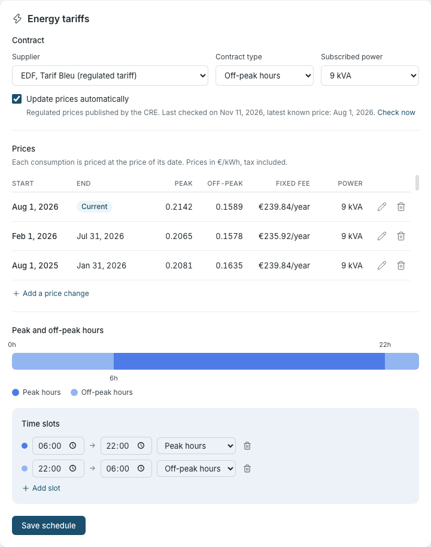

# Energy Monitoring

Sowel includes built-in energy monitoring that tracks your home's electricity consumption and (optionally) your solar production over time. It supports peak / off-peak tariff classification, autoconsumption tracking, and a by-usage breakdown when you instrument dedicated circuits.

## The three energy equipment types

Energy monitoring in Sowel is **integration-agnostic**. Any plugin that reports energy or power data on a device can feed the energy pipeline, as long as the device is bound to one of these three equipment types.

| Equipment type            | What it represents                                                   | Required device data                                           |
| ------------------------- | -------------------------------------------------------------------- | -------------------------------------------------------------- |
| `main_energy_meter`       | Your main grid meter (whole-home import / export)                    | Cumulative energy (Wh), or a signed grid energy delta per tick |
| `energy_meter`            | A submeter on a dedicated circuit (heat pump, pool, EV charger, ...) | Cumulative energy (Wh) **or** instantaneous power (W)          |
| `energy_production_meter` | Your solar (or other local production) meter                         | Cumulative production energy (Wh)                              |

You can mix and match: a setup with only a main meter is fine, you do not need solar to use the Energy page. Conversely, you can have many submeters without a main meter — you will just lose the "Other" residual on the by-usage view.

!!! info "Power-only submeters"
Cheap zigbee clamps that report only `power` (W) and not `energy` (Wh) are supported for submeters. Sowel integrates the power signal locally into a Wh stream attributed to the submeter equipment, with the same per-minute cadence as the main meter. State survives restarts.

## How the data flows

```
Energy meter device (any integration)
  -> Plugin reports `energy` (Wh) or `power` (W)
    -> HistoryWriter writes per-minute points to InfluxDB
      -> EnergyAggregator computes hour / day / month / year cumuls
        -> Energy page renders charts and totals
```

InfluxDB stores raw points in a short-retention bucket, then automatic downsampling tasks aggregate them into hourly and daily buckets with much longer retention. The Energy page picks the right bucket transparently based on the time range you are looking at.

!!! info "InfluxDB is automatic"
InfluxDB is mandatory and starts with Sowel via Docker Compose. On first launch, Sowel auto-creates the required buckets, downsampling tasks, and energy aggregation tasks. No manual InfluxDB configuration is needed.

## Setting up energy monitoring

### Step 1: Connect an energy integration

Install a plugin that provides energy meter devices (browse the catalogue from **Administration > Plugins**) and configure it from **Administration > Integrations**. Any plugin that surfaces a device exposing `energy` or `power` data is eligible.

### Step 2: Create the main energy meter equipment

Go to **Administration > Equipments** and create an equipment:

- **Type**: Main Energy Meter
- **Zone**: typically the Home root, or a Utility zone
- **Bind** to your grid meter device's `energy` data

Once bound, Sowel starts writing one energy point per minute to InfluxDB.

### Step 3: (Optional) Add a production meter

If you have local production (solar panels typically), create an equipment of type **Energy Production Meter** and bind it to your production meter device. With both a main meter and a production meter in place, Sowel computes:

- **Grid consumption**: energy drawn from the grid
- **Autoconsumption**: energy produced and consumed in the house
- **Grid injection**: energy produced and pushed to the grid
- **Total consumption**: grid + autoconsumption

### Step 4: (Optional) Configure your contract, prices and off-peak hours

Go to **Settings > Energy**, card **Energy tariffs**:



1. **Contract.** Choose your supplier, the contract type (off-peak hours, or a single rate) and your subscribed power. They describe your contract; they price nothing by themselves. With **EDF, Tarif Bleu**, tick **Update prices automatically**: Sowel then reads, once a day, the prices published by the French regulator (CRE) for your contract type and power, and the line under the option says when it last checked and the latest price it knows. **Check now** reads them at once.
2. **Prices.** Prices are a history: each row is valid from its start date until the day before the next one, and each consumption is priced at the price in force on its date. So a price change never reprices the past.
   - **Add a price change** when your prices change: enter the date it starts, the peak and off-peak prices per kWh including tax, and optionally the fixed fee per year and the power. You can enter it ahead of time, or late: the days already measured are then repriced from that date.
   - The pencil corrects a row; the bin deletes it. The oldest row, **Origin**, covers everything before the first dated change: it can be corrected, not deleted.
   - The list shows the three latest prices and scrolls for the older ones.
   - **Prices found for your contract.** With automatic prices on, a new period (each February and August) is added by itself, at its real start date, and you are notified. Everything else waits for you in a panel above the list: the past prices the first time (after an upgrade, or when you set your contract), a price published late that starts before a change you entered yourself, and a jump of 30 % or more. **Add these prices** adds them; **Ignore** sets them aside, and they are not proposed again unless you ask (**Propose them again**) or change your contract. Check your subscribed power first: it sets the fixed fee of every row.
   - Automatic prices never change a row that exists. If you take the history for one power and then change your power, the dates are already used and nothing is proposed: correct the fees by hand, or delete the rows and take the list again. A row from the price file that you delete is set aside, so it does not come back the next day.
   - With a single-rate contract, one price is asked. Past rows that hold a peak and an off-peak price keep both.
3. **Peak and off-peak hours.** Define your time slots: which hours are peak and which are off-peak, with as many slots as you need to cover the 24 hours of the day. **Save schedule** saves the hours only.

Prices are used for the cost views; the peak / off-peak split works without them. If no schedule is configured, all consumption is classified as peak by default — you simply do not see the split.

When you upgrade from a version that had one pair of prices, Sowel keeps them as the **Origin** row: your figures do not move until you add or correct a price.

### Step 5: (Optional) Add submeters for a by-usage breakdown

To know how your main meter's consumption splits across circuits, add an `energy_meter` equipment for each circuit you instrument.

1. Install a zigbee energy clamp, smart plug, or Wi-Fi meter on the dedicated circuit
2. Go to **Administration > Equipments** and create an equipment of type **Energy Meter**
3. Bind it to the device's `energy` (Wh) data, or — if your device reports only `power` (W) — to its `power` data: Sowel integrates the power signal into a Wh stream automatically

Once at least one submeter is configured, the **By usage** toggle appears on the Consumption page. The toggle is hidden when no submeter exists.

## Using the Energy section

The sidebar groups the energy views under **Energy**:

- **Live**: instant flow between grid, production, and house consumption
- **Costs**: what electricity cost, what solar avoided and what the arbiter earned, by day, month or year
- **Consumption**: historical consumption with peak / off-peak split and self-consumption overlay
- **Production**: historical solar production with autoconsumption / injection split

### Live view

The Live view shows what is happening right now — power values updated in real time via WebSocket.


At the top of the card, one line answers the first question: **Grid import**, **Grid export** or **Self-powered**, with the power in large figures and one sentence under it ("The sun covers 4 % of the 5 kW consumed", "The house consumes 800 W, all of it from the sun", or "No solar production"). Without a production meter, or without a main meter, the line shows the consumption alone. When a reading behind it is late, the sentence ends with its age; the banner described below says the rest.

Under that line, the diagram shows three boxes (Grid, Consumption, Production). The word **import** or **export** under the grid figure says which way it flows (nothing within 5 W of balance). Each route carrying power is a ribbon of one width; a soft wave of colour runs along it, faster when more flows, and an arrowhead where it reaches its destination gives the direction, even on a still screen. With the system's reduced-motion setting the wave stops and the ribbon takes a stronger colour; its arrowhead still says which way, and the bars below how much. The shares sit under the figures, not on the routes: a small bar under the consumption splits it between the grid and the sun, with both percentages at its ends (one colour at night or on export), and while exporting a bar under the production splits it between the house and the grid. The colours sit on the icons and the routes; the figures are in the text colour, so they stay legible in both themes. A screen reader hears the whole flow as one sentence.

On a wide screen (from 1024 px), the flow and the consumption breakdown sit side by side, with the phase bars of a three-phase meter under the breakdown; on a tablet or a phone they stack as before. The breakdown shows its legend under the donut, centred in its card, on every screen. The breakdown lists only the loads drawing power, largest first. The ones at 0 W are named together on one line underneath ("Off: Pool, Freezer"), and **Other**, the consumption no sub-meter accounts for, comes last, marked "not metered". A load whose reading is late or offline keeps its own line and says so.

Tiles are hidden when their underlying equipment is not configured: with no production meter, only Grid and Consumption are shown.

A banner appears above the diagram when a reading can no longer be trusted, one line per source and
each with its own age. It says one of three things:

- **"no reading received for 12 min"**: nothing has arrived from that meter for a while. The
  window is ten minutes, which is twice the slowest reporting cadence any supported source uses, so
  a meter polled every five minutes never raises this while it is working.
- **"reading stuck on the same value for 3 h"**: readings keep arriving, but the value inside
  them stopped moving. That is a source still talking without measuring, and no arrival time can
  reveal it. Sowel compares the value as stored, at full precision, never the rounded figure drawn
  on the diagram: production shown as 2.4 kW may be swinging by 49 W without the display changing at
  all. Two exceptions are left alone: a reading of exactly zero, which a production meter genuinely
  holds all night, and anything under an hour, so an inverter sitting on its clipping plateau
  through a clear noon says nothing.
- **"no connection for 20 min"**: the meter's device has dropped off the network altogether.

Only the power readings the diagram draws are watched, so a meter that is merely late on a voltage
or energy reading raises nothing here.

### Costs view

The Costs page answers, in euros, for a **Day**, a **Month** or a **Year** (the arrows move through dates, and the period and date are the same as on the Consumption page). It needs a tariff: without one, it asks you to set it in **Settings > Tariff**.

- **The bill.** The large figure is what the grid cost over the period, split into peak and off-peak hours. It is the same total as the € view of the Consumption page. Under it, one comparison: for a day, the average of the 7 days before; for the current month, what the month will cost at this pace, and the same month a year earlier; for a year, the months that have readings almost every day in both years ("May to October: 474 €, against 939 € in 2025 (−50 %)").
- **Electricity used, in euros.** With a production meter, a bar splits what the electricity you used was worth into what you **paid** the supplier and what solar **avoided**: the self-consumed solar kilowatt-hours priced at what they would have cost at that moment. "Without panels, the bill would have been …" is the sum of the two.
- **Solar savings** and **Arbiter gain.** Two tiles repeat the avoided figure with the self-consumed energy, and give the arbiter's share of it (see [What the arbiter earns](#what-the-arbiter-earns)). The arbiter tile shows when the arbiter is enabled, or when the period holds a gain measured while it was.
- **Cost per hour, day or month.** Stacked bars: paid at peak, paid off-peak, and avoided by solar on top. In the year view a dashed tick marks the previous year's bill for the same month.
- **By usage.** One row per sub-meter, plus **Other**: its kilowatt-hours, what it cost, what solar avoided for it, sorted by the amount paid. Each hour (day view), day (month view) or month (year view), the home's solar share is applied to every sub-meter, so these figures are a little more precise than the by-usage € of the Consumption page, which prices each sub-meter's kilowatt-hours whole, solar included.
- **How these amounts are made.** The last card (folded on a phone) gives the prices used and these rules.

### Consumption view

Pick a period (Day, Week, Month, Year) and navigate dates with the arrows. On a phone the controls stack in one left-aligned column, the period tabs at full width.

The card opens on the answer: the period's total consumption in large type, with « today », « this week »… beside it (or the date, for a past period), then one sentence of what it is made of: `9.44 kWh at peak hours · 1.97 kWh at off-peak hours · 3% self-consumed`. The chart below renders bars for each time bucket of the selected period, with its axes and tick values.


Color coding on the **Total** chart:

| Color      | Meaning                                                  |
| ---------- | -------------------------------------------------------- |
| Dark blue  | Peak-hours grid consumption                              |
| Light blue | Off-peak-hours grid consumption                          |
| Green      | Autoconsumption (only when a production meter is set up) |

The legend below the chart has one swatch per colour, peak and off-peak included, with names only: the figures are in the headline above. The dark theme keeps the same meanings with its own shades: peak stays the vivid blue and off-peak the pale one, far enough apart to tell two stacked bars from each other. Hovering a bar opens a tooltip with the same swatches; its labels and figures are in the text colour, which the pale blue would not be legible as.

The total counts everything the house used, grid and sun; the self-consumed share is the sun's part of it.

#### Wh / € unit toggle

A **Wh / €** segmented toggle sits next to the period selector at the top of the page. In **€** mode, every kWh figure on the bar chart (Y axis, bar height, tooltip) and in the headline is replaced by the corresponding cost in euros, computed from the prices you entered in **Settings > Energy tariffs**. The toggle is disabled — with a tooltip pointing back to the tariff settings — until you set at least one of the HP / HC prices to a non-zero value.

Pricing is applied at read time, each consumption at the price in force on its date ([price history](#step-4-optional-configure-your-contract-prices-and-off-peak-hours)): a price change applies from its start date, and correcting a past price re-values the consumption of that period only. In the month and year views, the first hour or two of the night of a price change are still priced at the previous price. Autoconsumption has no billed cost and is therefore hidden from the chart in € mode, and left out of the € total: the headline then reads the bill, split into peak and off-peak, with the self-consumed share still given as a percentage of energy.

#### Total / By usage toggle

When at least one submeter is configured, a **Total / By usage** toggle appears beside the headline. It, the Wh / € toggle, the period tabs (here and on the Analyse page) and the forecast's window buttons are the same segmented control. The **By usage** view replaces the peak / off-peak split with one stack per submeter, plus an **Other** stack for the residual that the main meter saw but no submeter accounted for. The headline then gives the total of those stacks, the grid energy the main meter measured, without the peak / off-peak sentence.


Submeters take their colors from an eight-color series palette, in a fixed order (sorted by equipment), so the same circuit keeps the same color across days, views and the Live breakdown. The palette has no red, orange, amber or solar green, since those colors carry a meaning elsewhere, and each color has a light and a dark variant. The Analyse page uses the same palette; a chart saved with the earlier palette shows the new color at the same position. The "Other" stack is clamped at zero, so a submeter that briefly overshoots the main meter (due to sampling skew) cannot make it negative.

In €, every submeter is valued hour by hour (day by day in the week and month views, month by month in the year view), at the average price the house paid in that same hour: a load that runs off-peak is priced off-peak. It still counts solar kilowatt-hours at the grid price, so an EV charger that charges on solar surplus costs less than this figure. Its exact cost, split peak / off-peak / solar and per car, is on the charger's and the vehicle's pages ([charging sessions](equipments.md#charging-sessions-and-cost-per-vehicle)).

##### When one meter is fed from another

Switchboards nest: a gîte measured by one clamp, and its water heater — fed from that same board — by a second one. Both are submeters, so without help the heater's kilowatt-hours would be counted twice, once in each stack, and the "Other" residual would lose exactly as much.

Say so on the inner meter: open its equipment page and pick, under **Already counted by**, the meter it is fed from. The breakdown then shows the outer meter **net of the inner one** — the gîte minus its water heater — while the inner one keeps its whole measurement, and the two stacks stop overlapping. Its legend says "net of its submeters" so the slice can be told apart from the meter's own card, which keeps showing what its clamp measures.

Chains work: with a main board feeding a gîte feeding a water heater, each level is shown net of the one directly inside it, and the three still add up to the board.

The same subtraction applies to the live breakdown on this page, so the donut and the daily stacks tell one story rather than two.

Two things worth knowing: deleting the outer meter clears the declaration on the ones inside it, which starts counting them twice again, so re-declare their new parent if the wiring still nests; and the equipment cards always keep showing what each clamp measures, since a card contradicting its own sensor would be worse than the overlap it fixes.

##### When a meter is fed by a separate supply

The opposite topology exists too: a clamp on a circuit fed by **another utility meter** — an EV charging socket on a second subscription, say. Its kilowatt-hours never flow through your main meter, so counting it in the breakdown invents consumption the main meter never saw, eats the "Other" residual down to zero, and prices another supply's energy at your main tariff.

Say so on the meter: open its equipment page and tick **Fed by a separate supply**. The meter then leaves the by-usage partition and the live donut, and shows up **apart** — its own group under both, in kWh only, never in € (Sowel does not know the other supply's tariff). Its card, its history and its charts are untouched: the measurement is as real as any other, it just belongs to a different balance.

A separate-supply meter cannot be picked under **Already counted by** — nothing the partition renders can be "inside" a meter on another supply.

##### When a solar panel sits behind a submeter

A small panel can be wired behind a submeter rather than through the production meter: a few modules on the pool house roof, behind the pool clamp. When the panel produces more than the circuit draws, the clamp reads **negative** watts. By default Sowel takes a negative reading for a clamp mounted backwards and counts its absolute value as consumption, so the panel's output would inflate the circuit's slice, shrink "Other" by as much, and never appear as production.

Say so on the meter: open its equipment page and tick **Local production flows through this meter**. From then on:

- the circuit's slice keeps the positive part of its reading. The clamp measures the circuit **net of the panel**, so while the panel covers part of the pump's draw, that part shows up neither as consumption nor as production;
- the negative part counts as **solar production** of the house: it is added to the total production, to self-consumption, and to the household consumption that is rebuilt from them;
- on the live page, the circuit's row shows its load only and the panel's output joins the solar flow.

It works whether the circuit is drawing or producing at a given moment: every interval between two readings is split at the point where the power crosses zero. It applies from the moment the box is ticked — past history is not rewritten; unticking it later keeps what was already counted. It needs an **Energy Meter (production)** equipment to be configured, since that is where self-consumption is recorded.

The box is offered only on a meter that reports power alone (Sowel computes its energy): a meter with its own energy counter cannot be split by sign. It cannot be combined with **Fed by a separate supply**: that panel's output never reaches your main meter. If the meter is declared inside another one (**Already counted by**), the outer clamp sees the panel too and is not split: tick the box on the innermost meter carrying the panel only.

Totals widgets (peak / off-peak, autoconsumption) stay unchanged when you toggle modes.

#### Longer periods

Switching to **Month** or **Year** keeps the same colors and totals, but each bar represents a day (Month view) or a month (Year view).


### Production view

The Production page is the home of everything about your panels. Its card opens on the energy produced over the period; on today's Day view it reads against the forecast, `0.39 kWh of 7.93 kWh expected today`, and the sentence under it splits it between autoconsumption (produced and consumed locally) and grid injection. The chart below keeps its axes. On today's Day view its scale reaches at least the forecast's busiest hour, so a morning's first bars sit in the frame of the day to come rather than filling a half-kilowatt-hour one.

Since v1.57.0 it also carries two panels, both driven by your own installation rather than by a generic model:

- **Forecast**, an hourly expected-production curve out to five days (« Expected » as a dashed grey line, the measured production « Actual » as a solid green line, the green of the bars above), learned from your history. It needs the `weather-forecast` plugin at 2.3.0 or later, and about six weeks of production before the model settles. Before that, Sowel shows a provisional clear-sky estimate and says so.
- **Health**, which tells you when the panels stop performing against what your own history says they should. Declaring a new array, or changing the peak power, re-estimates the gain from the days that follow rather than waiting for the window to drift.

Both are described at length in [Following your solar production](../deep-dives/pv-health.md).

**Reading the accuracy figure.** Under the two daily totals the forecast panel states how far it has been off: `± 1.15 kWh (5.2%) over 9 complete days, forecast a day ahead`. It is the error on the **energy of a day**, averaged over the finished days in the window, and the percentage is that error as a share of what those days actually produced. Only complete days count: a day the meter did not cover throughout is dropped rather than blamed on the model.

The running day gets its own line, `Today so far`, comparing what was forecast the day before for the hours already elapsed with what was measured over those same hours. It answers whether today is on track, which the multi-day average cannot.

Before v1.68.0 this figure was a mean of hourly power errors in watts. Roughly half of any window is night, where nothing is expected and nothing is produced, so those perfect hours halved the number, and it improved on its own every autumn as the nights lengthened. An energy total cannot be diluted that way.

The buttons above the chart choose how much history it draws: one day, three days, a week, a month or three months. They are a zoom on the curve only. The accuracy figure always looks back at least a week, so zooming in to inspect a single day does not leave it without enough finished days to say anything.

## Surplus arbitration

When you have solar production, several automations may want the same surplus at the same time (pre-cooling the house, running the pool pump, heating water). Left uncoordinated they fight over it: each switches on when it sees export, together they overshoot, the export collapses, and everything switches off again. The **surplus arbiter** is the single referee that hands the surplus out in an order **you** decide.

It is **off by default** and changes nothing until you enable it. On a home without solar production it stays hidden.

### Declaring a flexible load

On an equipment whose type is a controllable load (pool pump, water heater, water valve, VMC, EV charger, heater or thermostat), open its page and turn on **Energy management**. You set:

- **Nominal power** — pre-filled from the equipment's own measurement when a clamp is bound.
- **Tolerated import (W)** — how much grid import this load will accept to start on a **partial surplus**. The arbiter engages it once the surplus covers "nominal power + margin − tolerated import". At `0` (default) it waits for a full surplus; raising it makes the load start sooner, accepting to buy a little grid. It is the load's comfort / economy dial, set once here and honoured by whatever automation drives it.
- **Minimum on / off** — how long it must stay on once started, and rest before restarting (protects a compressor from short-cycling).
- **Shutdown delay (min)**, optional: how long this load keeps drawing after the arbiter releases it, before it actually stops (for example a heat-pump water heater whose pump runs about 30 min after its solar contact opens). Leave it empty for a load that stops promptly; declare it for an inertial one so the arbiter does not flag its expected, slow shutdown as "did not turn off on demand". It widens that grace for this load only and never slows the arbiter's reaction for the others.

How the arbiter treats the load is **derived from its type**, so there is nothing to pick:

- a **relay** whose on/off is a command (pool pump, water heater, EV charger) can be switched off and run later on the surplus, and an unexpected on/off is read as you taking manual control;
- a **self-regulating** load (a thermostat or air conditioner) has its normal operation only complemented by the surplus, and the arbiter does not read its own on/off cycling as an action from you.

An equipment type with no energy behaviour (a plain light or a generic switch) cannot be declared a flexible load.

Enabling this only _declares_ the load. Nothing acts on it until the arbiter itself is enabled.

### Enabling the arbiter and setting priority

Go to **Settings > Administration > Energy**, enable **Surplus arbiter**, and order your flexible loads in the priority list. The list is read both ways: the surplus is offered top-down, and when it runs short the bottom load is the first to step back. Advanced timing thresholds live behind a fold with sensible defaults.

### Reading it on the Live page

The **Energy > Live** page gains a surplus-arbitration panel with three parts:

- a **roster** listing every flexible load in your priority order, with its state and its figures;
- a **history** of the last hours: the surplus and the deficit as a curve, then one lane per flexible load;
- a **decision journal** in plain language, so nothing the arbiter does is a mystery.

The sticker beside the title says where the house stands: _Surplus 1.2 kW_ on a green tint when it exports, _Deficit 4.8 kW_ on the grid's slate blue when it imports. A deficit is the normal state of a morning or an evening, not a fault, so nothing turns red; red is kept for a load whose surplus was withdrawn. While the house imports, one line under the title says _No load can start while the house imports._

The roster answers the two questions you actually have in front of it: who has the surplus, and what is holding up the next one. Hover a column header for a one-line definition.

| Column               | What it says                                                                                                                                                                                                                                                                                                                                                                                                                  |
| -------------------- | ----------------------------------------------------------------------------------------------------------------------------------------------------------------------------------------------------------------------------------------------------------------------------------------------------------------------------------------------------------------------------------------------------------------------------- |
| **Short by**         | What a waiting load is still short of, in watts. While the house imports, a waiting load reads _deficit_ instead: every one of them is short by the whole deficit, and the figure comes back with the surplus. When nothing is missing it says so in words: _covered_ for a load that already has the surplus, _not requested_ for one no automation has asked for, or the reason it is held back (confirming, cooling down). |
| **Power**            | What the load draws: measured while it runs, its rating while it rests.                                                                                                                                                                                                                                                                                                                                                       |
| **Tolerated import** | The grid import it accepts, from its energy management settings.                                                                                                                                                                                                                                                                                                                                                              |
| **Surplus needed**   | The surplus it takes to start it: **power + engage margin − tolerated import**. The column header's tooltip gives the margin, so you can check the arithmetic on any row. A load tolerating more import than it draws needs no surplus at all and reads 0 W.                                                                                                                                                                  |

The number in front of each name is its rank in your priority list, as the tooltip of the _Equipment_ header says. On a narrow screen the table keeps the equipment, its state and what it is short by, and drops the rest. _Next to switch_ names the first waiting load and the surplus it will start from (_Will start from 600 W of surplus_).

At night the arbiter goes dormant: there is no surplus to hand out, every load reads _at rest_, and the panel says when it resumes.

#### The history

The curve is drawn to scale: zero sits where the window's own peaks put it, a watt has the same height above and below the line, and each half is labelled with what its edge stands for (_+0.3 kW_ at the top, _4.8 kW import_ at the bottom). On the live window the curve runs up to now and ends on a dot carrying the current figure, the one the sticker shows.

Each lane draws a stretch of the same state as one bar, so a night at rest reads as one long pale bar rather than forty cells. The legend lists only the states the window shows, plus _At rest_. A load waiting for surplus while the arbiter was dormant (sun down, nothing exported) reads _at rest_ for those quarters too, as the roster did at the time: it was not waiting for anything that could come before sunrise.

Point at the history with a mouse for a readout of that quarter of an hour: its time, the import or surplus, and what every load was doing. On a phone, tap a quarter to bring its decisions up in the journal. With a keyboard, each lane is one Tab stop: the left and right arrows move between quarters, Enter shows them in the journal. The arrows above the curve page back through the last 48 hours, 6 hours at a time on a phone and 12 hours from a tablet.

### What the arbiter earns

Every minute, Sowel notes the solar energy used by the loads the arbiter switched on, and whether that minute was peak or off-peak. Its value in euros is computed when you read it, at the prices in force that day. The loads are served **last** by the sun: when the house imports, the import is charged to them first, so the figure never claims solar the house itself used. The result builds up per day and per load and shows on the Costs page, in the **Arbiter gain** tile, with the two loads that earned most. It is part of the solar savings, not added to them. A load is counted at its measured power when it has its own meter; without one, at its learned or declared power for as long as it is granted, so a load that stops by itself (a water heater whose thermostat cuts off) is overstated until it is released.

The measure starts the day the version that brings it is installed: earlier periods read "Not measured yet".

### You always win

If you switch a flexible load on or off yourself — in the app, with a physical button, or the switch on the wall — the arbiter steps back and leaves it alone for two hours. Its equipment page shows _Manual until HH:MM_ with a **resume control now** button if you want to hand it back sooner.

## Data pipeline

Understanding how data flows helps with troubleshooting:

```
Plugin reports energy or power
  -> per-minute energy points written to InfluxDB "sowel" bucket  (7-day retention)
    -> sowel-energy-sum-hourly task
      -> "sowel-energy-hourly" bucket  (2-year retention)
        -> sowel-energy-sum-daily task
          -> "sowel-energy-daily" bucket  (10-year retention)
```

The Energy page chooses the bucket based on the period:

- **Day view** for today and recent days: queries the raw bucket for real-time accuracy
- **Day view** for older days: queries the hourly bucket
- **Month / Year**: queries the daily bucket for fast, long-range queries

The aggregator also keeps in-memory cumuls (hour, day, month, year) that the Live view and Home page widgets read directly, refreshed on every new energy tick.

## Troubleshooting

### No data appears on the Energy page

1. Check that the integration providing your energy meter device is connected (green indicator in **Administration > Integrations**)
2. Verify the equipment exists (Main Energy Meter and/or Energy Production Meter) and is bound to a device that actually emits `energy` data
3. Wait for at least one polling / push cycle — exact frequency depends on the plugin, but typically a few minutes at most
4. Check **Settings > System > Logs** for messages from the `history-writer` or `energy-aggregator` modules

### Peak / off-peak shows everything as peak

This means no tariff schedule is configured. Go to **Settings > Energy** and define your slots.

### Old data is missing

Data older than 7 days lives only in the downsampled hourly and daily buckets. If those buckets are empty, the downsampling tasks have not run yet (they run once per hour and once per day). Check that InfluxDB is running and reachable, and inspect the logs of the `history-writer` module on startup — Sowel logs whether the tasks were created or already existed.

### By usage view shows a large "Other" residual

This means your submeters do not cover most of the main meter's consumption — which is normal: the main meter sees everything in the house, while submeters typically cover specific high-power circuits. The residual is "Other circuits".

If the residual is **negative** (clamped to zero in the chart), one of your submeters is reporting more than the main meter sees — usually a clamp wired backwards or a calibration mismatch. A power-only clamp reading negative watts is integrated as its absolute value, with a WARN logged once — unless it is declared as [seeing local production](#when-a-solar-panel-sits-behind-a-submeter).
