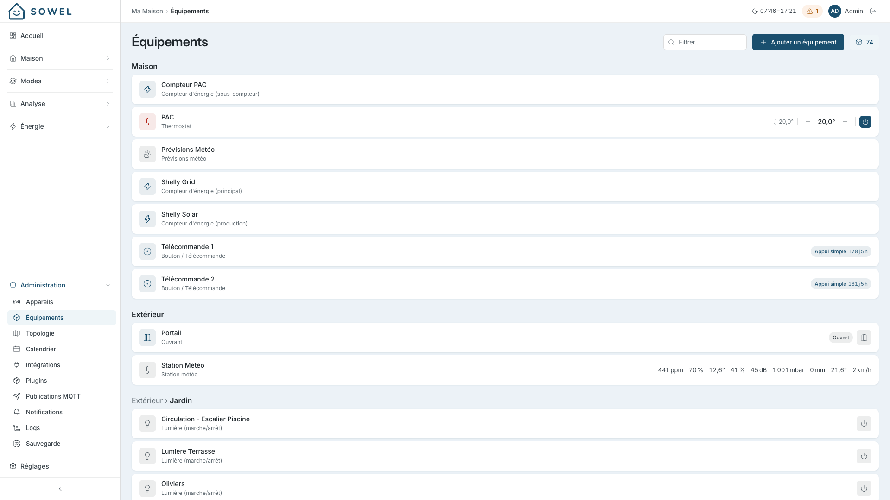

# Équipements

Les équipements sont le concept central de Sowel. Un équipement est une **unité fonctionnelle** avec laquelle vous interagissez au quotidien : "Spots Cuisine", "Volets Chambre", "Capteur Cuisine".

**Un device est ce qui est sur le réseau, un équipement est ce qui est dans la pièce.** Vous ne pensez jamais au module variateur Zigbee installé derrière le mur, vous pensez aux lumières de votre cuisine.

## Créer un équipement

Allez dans **Administration > Équipements** et cliquez sur **Ajouter un équipement**.

### Étape 1 : Informations de base

| Champ       | Obligatoire | Description                                                                             |
| ----------- | ----------- | --------------------------------------------------------------------------------------- |
| Type        | Oui         | La catégorie de l'équipement (voir [Types d'équipements](#types-dequipements) plus bas) |
| Nom         | Oui         | Un nom parlant comme "Spots Cuisine" ou "Capteur Cuisine"                               |
| Zone        | Oui         | À quelle pièce ou zone cet équipement appartient                                        |
| Description | Non         | Une note pour vous-même                                                                 |

!!! info "Le type ne peut pas être modifié après création"
Choisissez le type avec soin, il détermine quels devices sont compatibles et comment l'équipement est affiché. Seule exception : un volet, un store banne et une porte peuvent être changés l'un en l'autre depuis le formulaire **Modifier** de l'équipement, car ils se lient de la même façon (voir [Porte](#acces)).

### Étape 2 : Sélectionner les devices

Cliquez sur **Suivant : Sélectionner les devices** pour voir la liste des devices compatibles. Sowel filtre automatiquement les devices selon le type d'équipement.

- Sélectionnez un ou plusieurs devices
- Cliquez sur **Créer**

**C'est tout.** Sowel crée automatiquement toutes les liaisons de données et de commandes. Chaque valeur que le device expose (température, humidité, batterie...) devient immédiatement disponible sur l'équipement.

!!! tip "Vous pouvez ignorer la sélection de device"
Vous pouvez créer un équipement sans device et en lier un plus tard depuis la page de détail.

### Liaison multi-devices

Un seul équipement peut se lier à **plusieurs devices**. C'est une des fonctionnalités les plus puissantes de Sowel.

**Exemple :** Trois modules variateurs IKEA séparés alimentent les spots de votre cuisine. Créez un seul équipement "Spots Cuisine" et liez les trois. Un seul interrupteur allume les trois. Un seul curseur les variégradue tous les trois.

---

## Types d'équipements

### Lumières

#### Lumière (On/Off)

Contrôle simple on/off d'une lumière.

- **Contrôles :** Bascule Marche / Arrêt
- **Données attendues :** état (on/off)

#### Lumière (Variateur)

Lumière à luminosité réglable.

- **Contrôles :** Bascule Marche / Arrêt + curseur de luminosité
- **Données attendues :** état, niveau de luminosité

#### Lumière (Couleur)

Lumière à couleur réglable, avec température de couleur en option.

- **Contrôles :** Bascule + curseur de luminosité + contrôles de couleur
- **Données attendues :** état, luminosité, couleur, température de couleur

---

### Volets

#### Volet

Volet roulant motorisé, store ou volet.

- **Contrôles :** Boutons Ouvrir / Stop / Fermer, affichage de la position
- **Données attendues :** position (0 % = fermé, 100 % = ouvert)

#### Store banne

Store banne extérieur motorisé.

- **Contrôles :** Boutons Rétracter / Stop / Déployer, affichage de la position
- **Données attendues :** position (0 % = rétracté, 100 % = déployé)

Le store banne partage la surface de contrôle du volet (même binding `shutter_position`, mêmes boutons OPEN/STOP/CLOSE) mais affiche un vocabulaire dédié dans toute l'UI : pastilles _Déployé / Rétracté_, boutons _Déployer / Rétracter_, groupe "Stores bannes" séparé dans la vue zone. Mapping : RF-up = rétracter = position 0, RF-down = déployer = position 100. Le plugin [somfy-rts](https://github.com/mchacher/sowel-plugin-somfy-rts) couvre les deux familles (volets + stores) sur le même matériel Somfy RTS.

---

### Climatisation

#### Thermostat

Contrôle de chauffage ou de climatisation : climatiseur, poêle à granulés, pompe à chaleur.

- **Contrôles :** Affichage de la température, consigne (− / +), allumage/extinction, mode
- **Cœur :** température courante, consigne, état de marche, alimentation, mode de fonctionnement
- **Extras** (selon le device) : tout le reste, vitesse du ventilateur, ioniseur, profil de poêle…

Un thermostat a un **cœur** et des **extras**. Le cœur est le petit ensemble que tous les thermostats partagent et sur lequel toutes les surfaces de Sowel s'appuient : `temperature`, `setpoint`, `state`, `power`, `operationMode`, plus `outsideTemperature` quand l'unité a une sonde extérieure. Sowel reconnaît un device comme thermostat dès qu'on peut lui donner une consigne, quel que soit le nom de la clé chez le plugin. Tout ce que le device offre en plus (une vitesse de ventilation, un ioniseur, le programme et la remise à zéro d'alarme d'un poêle à granulés, un réglage d'un fabricant que Sowel n'a jamais rencontré) est lié aussi, mais comme **extra** : la carte mène avec le cœur et liste les extras dans une section secondaire, un contrôle par commande liée (des boutons pour un choix, un interrupteur pour un marche/arrêt, un bouton d'action pour un déclenchement, un pas à pas pour un nombre) et une puce par lecture. Les extras varient d'un thermostat à l'autre et ne définissent jamais le type. Le mode de fonctionnement utilise un vocabulaire commun : `auto`, `heat`, `cool`, `dry`, `fan`, et `off` sur les unités dont le mode porte l'arrêt.

Sur un thermostat, l'état marche/arrêt rapporté par le device lui-même est lié sous l'alias `state`, le même alias marche/arrêt que les équipements à relais. C'est important sur un thermostat **sous-compté** (une pompe à chaleur mesurée par une pince) : l'alias `power` y porte la puissance instantanée, et un wattage ne dit pas à l'interface si l'unité est allumée ou en veille. Si la carte du thermostat ne passe jamais à « Marche », ouvrez le panneau des liaisons manquantes de l'équipement et ajoutez la donnée d'alimentation du device : elle est proposée sous `state`. Les thermostats existants dont le booléen est lié directement sous `power` continuent de fonctionner sans changement.

La consigne a les mêmes boutons − / + sur la page de l'équipement, dans les lignes de Maison, sur l'Accueil et dans son panneau sur téléphone, comme les extras numériques d'un thermostat, le courant d'une borne et la limite de charge d'une voiture. La valeur suit chaque toucher tout de suite et un seul ordre part après le dernier : environ 0,6 s plus tard pour un appareil cloud, 0,15 s pour un appareil local. Voir [Accueil](dashboard.md#widget-dequipement).

#### Radiateur

Radiateur électrique individuel piloté par relais fil pilote.

- **Contrôles :** Bascule Confort / Éco
- **Données attendues :** état du relais (ON = éco, OFF = confort)

#### Chauffe-eau

Chauffe-eau / cumulus piloté par un relais on/off. Le canal on/off est lié automatiquement (ainsi que sa puissance/énergie si le relais les mesure).

- **Contrôles :** Bascule Marche / Arrêt, plus une bascule **Solaire** dédiée lorsqu'un canal solaire est lié
- **Données attendues :** état du relais on/off, température d'eau optionnelle (affichage seul, exclue de la moyenne de température ambiante de la zone), puissance/énergie optionnelles
- **Canal solaire (optionnel) :** un second on/off indépendant, lié sur un contact dédié (par exemple un relais Zigbee contact sec SONOFF MINI-ZBD qui pilote l'entrée photovoltaïque d'un chauffe-eau thermodynamique). Il est distinct de la marche normale de l'appareil : sur un chauffe-eau en alimentation permanente, seule la bascule Solaire apparaît. La carte affiche une bascule par canal lié (Marche/Arrêt si présent, Solaire si présent).
- La consigne réglable est volontairement hors périmètre (ce serait un thermostat). L'équipement fournit le canal de commande solaire (l'actionneur) ; la logique de pilotage sur surplus solaire reste dans une recette qui pilote ce canal via l'arbitre d'énergie.

---

### Accès

#### Portail

Portail, portail coulissant, ou porte de garage.

- **Contrôles :** Bouton Ouvrir/Fermer avec indicateur d'état
- **Données attendues :** état du portail (ouvert, fermé ; « État inconnu » sans capteur)

!!! tip "Icône sur l'Accueil"
Vous pouvez choisir une icône spécifique pour les portails sur l'Accueil : portail standard, portail coulissant, ou porte de garage.

Un portail peut être piloté par n'importe quel relais on/off : un module contact sec Zigbee (par ex. SONOFF MINI-ZBD), un canal de relais LoRa, ou une télécommande Somfy RTS. Le bouton de commande agit en impulsion ; configurez le comportement d'impulsion (inching / auto-off) sur le module lui-même. Associez un capteur d'ouverture (par ex. SONOFF SNZB-04P) au même équipement pour obtenir l'état ouvert/fermé ; sans capteur, l'état s'affiche comme inconnu.

Un administrateur peut activer la **Confirmation avant action** sur la page de l'équipement du portail. Chaque appui qui ferait bouger le portail demande alors d'abord — sur l'Accueil, dans la vue Maison, dans la liste des Équipements et sur la page de l'équipement, avec un curseur à glisser sur un écran tactile et une boîte de dialogue à la souris. Voir [Portails qui demandent confirmation](dashboard.md#gate-confirmation).

#### Porte

Porte motorisée qui reçoit des ordres explicites Ouvrir / Fermer / Stop et remonte sa position : porte de poulailler à fins de course, porte de garage pilotée par son propre protocole moteur.

- **Contrôles :** Boutons Ouvrir / Stop / Fermer, pastille d'état, curseur si une position est liée
- **Données attendues :** état de fin de course (ouverte, fermée, en ouverture, en fermeture, défaut) et/ou position (0 % = fermée)

Elle se lie comme un volet sans en être un : elle a son propre groupe « Portes » dans la vue zone, son propre comptage de zone (« portes 1/2 »), et aucune commande « fermer tous les volets » ne l'atteint. Une porte de garage pilotée par une seule impulsion sur un contact sec reste un **portail**.

La pastille lit d'abord le mot de la porte (Ouverte, Fermée, En mouvement, Défaut), et sa position quand elle n'envoie pas de mot. Dans le comptage de zone, une porte est ouverte tant qu'elle n'est pas prouvée fermée : en mouvement ou en défaut, elle compte comme ouverte ; un état inconnu ne compte pas.

!!! tip "Passer un volet en porte"
Un volet, un store banne et une porte peuvent être changés l'un en l'autre depuis le formulaire **Modifier** de l'équipement : le sélecteur de type propose ces trois-là. L'équipement garde ses liaisons, son historique, ses recettes et ses tuiles. Pour tout autre type, le sélecteur reste verrouillé. Une recette dont l'emplacement n'accepte que des volets continue de tourner, mais son sélecteur ne propose plus l'équipement la prochaine fois que vous la modifiez.

---

### Capteurs

#### Capteur

Capteur générique qui affiche une ou plusieurs valeurs mesurées. Sowel adapte l'affichage automatiquement selon ce que le device expose.

- **Contrôles :** Affichage en lecture seule avec icônes et unités appropriées
- **Données typiques :** température, humidité, pression, CO2, COV, luminosité, bruit, batterie
- **Capteurs booléens :** mouvement (Mouvement/Calme), contact (Ouvert/Fermé), fuite d'eau, fumée

#### Station météo

Capteur météo extérieur qui fournit les conditions actuelles.

- **Contrôles :** Affichage multi-valeurs
- **Données typiques :** température, humidité, pression, pluie, vent, bruit, batterie
- La pluie s'affiche en cumul sur 24 h et sur 1 h, plus « Pluie aujourd'hui » (depuis minuit) quand la station la remonte. Son historique se lit en barres, par heure ou par jour, chaque jour coupé à minuit heure locale.
- Les températures (extérieure et intérieure) affichent en dessous le minimum et le maximum mesurés depuis minuit, sur le widget du dashboard comme sur la page de détail. Fonctionne avec toute station qui remonte une température, sans configuration.
- Une station qui ne mesure que la pluie (un pluviomètre seul) a sa propre tuile sur l'Accueil : pluie du jour, cumul sur 24 h, et au clic les 7 et 30 derniers jours et la dernière pluie. Voir [Accueil](dashboard.md#widget-dequipement).

#### Prévision météo

Prévision météo sur plusieurs jours depuis une intégration API (par ex. plugin Open-Meteo).

- **Contrôles :** Cartes de prévisions jour par jour avec icônes des conditions
- **Données par jour (J+1 à J+5) :** condition météo, températures min/max, probabilité de pluie, rafales de vent

#### Bouton / Télécommande

Bouton physique ou télécommande. Pas piloté directement, utilisé comme déclencheur d'automatisations.

- **Données :** événements d'action (appui simple, double appui, appui long)
- **Usage :** Déclencher des [recettes](../technical/recipe-development.md) ou basculer des [modes](modes.md)

---

### Énergie

#### Compteur d'énergie

Suit la consommation d'énergie d'un circuit ou d'un device spécifique. Souvent utilisé comme **sous-compteur** sur une ligne dédiée (pompe à chaleur, piscine, borne VE) pour alimenter la [ventilation par usage](energy.md#bascule-total-par-usage) sur la page Énergie.

- **Contrôles :** Affichage de la puissance (W) et de l'énergie quotidienne (Wh/kWh)
- **Données attendues :** énergie cumulée (Wh)

#### Compteur d'énergie principal

Le compteur principal du réseau de votre maison. Un seul autorisé par système.

- **Contrôles :** Identique au compteur d'énergie, plus alimentation de la page [Suivi énergétique](energy.md)
- **Données attendues :** puissance, énergie (avec classification tarifaire HP/HC)

#### Compteur d'énergie de production

Panneau solaire ou autre source de production. Un seul autorisé par système.

- **Contrôles :** Affichage de la production avec calcul d'autoconsommation
- **Données attendues :** puissance de production, production cumulée

#### Véhicule électrique

Un **véhicule électrique** est une voiture électrique ou hybride rechargeable, lue depuis le cloud du constructeur. Sa carte dessine la voiture comme sa propre jauge : la carrosserie se remplit avec le niveau de batterie (ambre pendant la charge, rouge sous 20 %), et une borne avec son câble apparaît tant que la voiture est branchée. Dessous viennent le niveau de batterie, l'autonomie électrique, l'état de charge (_Branché_, _En attente de courant_, _En charge_…) et, quand le dernier relevé de la voiture a plus de 15 minutes, son ancienneté : une voiture endormie ne remonte rien, et un niveau de batterie ancien n'est pas celui d'aujourd'hui. Sa fiche ajoute les boutons **Réveiller** et **Démarrer la charge** et un réglage de la limite de charge quand la voiture le permet, ainsi qu'un petit bouton de relecture qui lit aussitôt le dernier relevé de la voiture (il ne réveille pas une voiture endormie), et montre la limite de charge sur la barre de batterie. Un clic sur la carte ouvre cette fiche, sur ordinateur comme sur mobile.

- **Contrôles :** Réveiller, démarrer la charge, limite de charge, relecture (selon la voiture)
- **Données attendues :** niveau de batterie, autonomie, branché, état de charge, heure du dernier relevé, à la maison (oui/non, sans coordonnées), kilométrage, limite de charge

Ce n'est ni un compteur d'énergie ni une charge pilotable : c'est la borne qui mesure et qui est pilotée. Le carburant et la climatisation d'une hybride restent visibles en extra.

#### Borne de recharge

Une **borne de recharge** pour véhicule électrique, portable ou murale. Sa carte indique si une voiture est branchée (_Débranchée_, _Branchée_, _En charge_), la puissance pendant la charge et l'énergie délivrée sur la session ; sa fiche ajoute la marche/arrêt et un réglage du courant de charge, borné par la plage de la borne. Sur mobile, un appui ouvre la fiche : lancer une charge ne se fait jamais d'un appui accidentel. Une borne ne propose pas de commande temporisée : sa charge est pilotée par une recette et l'arbitre énergétique.

- **Contrôles :** Marche/arrêt, état du véhicule, puissance, énergie de la session, courant de charge
- **Données attendues :** marche/arrêt (`state`), état du véhicule (`vehicle`), puissance (`power`), historique d'énergie (`energy`), courant de charge (`charge_current`), énergie de la session (`session_energy`), courant et tension mesurés

Sowel définit ce que porte une borne, quelle que soit l'intégration : une intégration qui publie ces données fournit une borne que Sowel reconnaît seul, et le sélecteur de devices la propose en premier. Le reste (code d'état, température, dernière session) reste visible en extra. C'est une charge pilotable et un sous-compteur, **reportable** par défaut pour l'[arbitre énergétique](energy.md).

La première borne prise en charge est la borne portable dé, via l'intégration [Tuya (local)](https://github.com/mchacher/sowel-plugin-tuya) à partir de sa version 0.2.0 (les versions antérieures publient la borne sans ces catégories). Charger sur le surplus solaire ou en heures creuses est le rôle d'une recette, via l'arbitre ; l'équipement ne fait qu'exposer et commander.

**Une borne qui ne remonte rien** (une wallbox sans connexion, par exemple) peut quand même être suivie par un compteur d'énergie sur sa ligne : une pince ampèremétrique ou un compteur modulaire que Sowel lit déjà. Créez une borne de recharge et choisissez ce compteur : le sélecteur de devices liste les compteurs d'énergie après les bornes, marqués _mesure seule_. Une telle **borne mesurée** affiche sa puissance et son énergie, sans marche/arrêt, et ses recharges sont détectées par sa puissance (plus bas). Une pince mesure une phase : sur une borne triphasée, elle ne voit qu'un tiers de l'énergie. N'y activez la gestion de l'énergie que si le compteur coupe aussi la ligne (un relais avec mesure) : sinon Sowel ne peut pas la couper.

#### Recharges et coût par voiture

Chaque branchement sur une borne est une **recharge**, du branchement au débranchement : les pauses et reprises (surplus solaire, nuages, heures creuses) restent une seule recharge, et une recharge de moins de 0,1 kWh n'est pas gardée. Son énergie est celle que mesure la borne, pertes comprises, puisque c'est ce que vous payez. Chaque tranche de 5 minutes est comptée à son tarif (heures pleines ou creuses), et **le solaire est gratuit** : la voiture passe après la maison, elle ne paie que ce que la maison a dû acheter au réseau à cause d'elle. Le coût est figé au prix du moment : changer vos prix plus tard ne change pas les recharges passées.

Sowel détermine ensuite **quelle voiture a chargé**, d'après ce que les voitures remontent par le cloud du constructeur : branchée, en charge, batterie qui monte, à la maison. Une voiture qui a dit être en charge ou branchée quelques minutes avant l'ouverture de la recharge compte aussi, sauf si une autre recharge était en cours à ce moment-là. Sowel attend deux heures après le débranchement, car le cloud d'une voiture remonte souvent en retard, et ne tranche que s'il est sûr ; sinon la recharge reste **À attribuer**. Toutes les voitures connues de Sowel sont candidates sur toutes les bornes.

- **La fiche de la borne** liste ses recharges mois par mois, avec la voiture de chacune (_auto_, _corrigée_, ou _À attribuer_ avec la raison). Un appui sur une recharge permet de choisir la voiture, **Autre véhicule** pour un invité (compté pour aucune voiture), ou **À attribuer plus tard**. Tout utilisateur peut le faire, pas seulement un administrateur, et le choix est définitif : Sowel ne le modifie plus.
- **La fiche de la voiture** a une section **Recharges à la maison** : le coût et l'énergie du mois, une barre réseau heures creuses / réseau heures pleines / solaire avec les kWh et les € de chaque part, le **coût aux 100 km**, et les recharges du mois.
- **La recharge en cours** apparaît aussi sur la fiche de la voiture, au-dessus du bilan, dès que Sowel sait à quelle voiture il l'attribuerait : la puissance en direct pendant la charge ; pendant une pause, depuis quand et pourquoi (borne coupée, limite de charge de la voiture atteinte, ou en attente de la voiture) ; après le débranchement, l'heure à laquelle elle sera attribuée, avec un bouton **C'est bien …** pour l'attribuer tout de suite. Elle ne compte dans le bilan du mois qu'une fois attribuée.

- **Une borne mesurée** ne dit pas quand une voiture est branchée : sa recharge commence quand sa puissance atteint 500 W et se termine après 30 minutes sous 500 W, datée de sa dernière minute active ; une pause de moins de 30 minutes reste dans la recharge. Le reste est identique : coût, part solaire, attribution, carte sur la voiture (sans la raison d'une pause).
- **Deux bornes.** Une voiture ne charge que sur une borne à la fois : une voiture que Sowel donne à une recharge sur une borne n'est pas candidate pour une recharge au même moment sur une autre. Et une borne peut avoir une **voiture habituelle** (sur sa fiche, pour un administrateur) : quand plusieurs voitures ont pu charger pendant une de ses recharges, la recharge lui revient (_voiture habituelle_). Elle ne prend jamais une recharge qu'aucune voiture ne revendique, celle d'un invité par exemple.
- **Deux voitures qui chargent en même temps** sur deux bornes remontent leurs relevés aux deux recharges. Sowel les distingue par ce qui est mesuré : la puissance à laquelle chaque voiture dit charger, comparée à celle de chaque borne (quand son intégration la remonte), puis l'énergie prise par la batterie de chaque voiture, comparée à l'énergie de chaque recharge (une fois que Sowel a appris l'énergie par point de batterie de chaque voiture). La liste affiche alors _auto · puissance_ ou _auto · énergie_. Quand rien ne les sépare nettement, les deux restent à attribuer. La voiture habituelle ne sert qu'à une borne qui charge toujours la même voiture.
- **Quand Sowel suppose, il le dit.** Une recharge attribuée par la voiture habituelle s'affiche _voiture habituelle_, comme celle de l'autre borne qu'elle a tranchée. Une voiture que Sowel a vue hors de la maison en dernier doit y être revue avant de pouvoir prendre une recharge. Quand deux voitures chargent en même temps, elles se partagent l'import réseau de la maison et son solaire.

Le coût aux 100 km est le prix payé par kWh à la maison, multiplié par la consommation de la voiture, que Sowel mesure lui-même : la batterie utilisée par km en roulant, et le nombre de kWh d'un point de batterie, appris sur vos recharges à la maison. Recharger ailleurs (au travail, sur autoroute) ne le fausse pas : un trajet pendant lequel la batterie est montée est écarté. Il apparaît après une première recharge à la maison d'au moins 10 % et 50 km mesurés dans le mois. Pour une **hybride rechargeable** (case sur sa fiche, pour un administrateur), il n'est pas affiché : une partie de ses km se fait à l'essence.

Les recharges commencent à l'installation de cette fonction : les mois précédents ne sont pas reconstitués. Énergie → Par usage montre toujours la borne au prix moyen du mois, son coût y diffère donc de la somme de ses recharges.

---

### Multimédia

#### Lecteur multimédia

TV, barre de son, ou appareil multimédia (par ex. TV Samsung SmartThings).

- **Contrôles :** Allumage/extinction, volume, mute, sélecteur de source d'entrée
- **Données attendues :** état d'alimentation, niveau de volume, mute, source d'entrée courante, mode image
- **Ordres :** allumer/éteindre, régler le volume, basculer mute, changer de source d'entrée

---

### Électroménager

#### Appareil électroménager

Appareil électroménager connecté tel que lave-linge, sèche-linge ou lave-vaisselle (par ex. Samsung SmartThings Washer).

- **Contrôles :** Affichage de statut en lecture seule
- **Données attendues :** état d'alimentation, état de fonctionnement (prêt/en cours/en pause), phase courante (lavage/rinçage/essorage), progression (%), temps restant, consommation d'énergie

!!! tip "Notification de fin de cycle"
Utilisez une recette de surveillance d'état pour être notifié quand l'état de fonctionnement passe de `running` à `ready`.

---

### Eau

#### Vanne d'eau

Vanne d'arrosage connectée pour le jardin. Conçue pour des devices comme la SONOFF SWV qui exposent `state`, `flow`, et les propriétés `irrigation_*`.

- **Contrôles :** Bascule Marche / Arrêt, action minutée "Arroser pendant X min" qui ouvre la vanne et laisse le firmware du device la refermer automatiquement après la durée configurée
- **Métriques live affichées si liées :** débit (m³/h), batterie, statut device (normal / manque d'eau / fuite)
- **Alias standards :** `state`, `flow`, `battery`, `status`, `duration`, `cycles`, `interval`, `capacity`, `autoCloseOnShortage`, seul `state` est requis, l'UI s'adapte à ce qui est lié
- **Agrégation de zone :** compte les vannes ouvertes/totales et somme le débit live sur l'arbre des zones
- **Base pour** de futures recettes d'arrosage automatique (planification consciente de la pluie)

### Caméras

#### Caméra

Type générique, indépendant du fabricant : tout plugin caméra qui remonte les bonnes données peut s'y lier.

- **Contrôles (si liés) :** vue en direct, actualisation de l'aperçu, activer/désactiver la surveillance, spot lumineux, sirène
- **Données attendues (si liées) :** aperçu, flux en direct, état de surveillance, mode du spot, dernière détection

!!! tip "Chaque fonctionnalité est activée à la carte, par caméra"
Qu'une caméra propose un flux en direct, un bouton de surveillance ou remonte des détections dépend uniquement des données/ordres que vous liez — le même mécanisme de liaison que pour tous les autres types d'équipement. Créer une caméra à partir d'un device détecté lie automatiquement l'aperçu, le flux en direct et la bascule de surveillance ; le spot, la sirène et les détections restent à activer manuellement depuis la page de détail ("Ajouter une liaison") si vous le souhaitez. Une fonctionnalité non liée reste inaccessible même via l'API, pas seulement masquée dans l'interface — c'est un choix de confidentialité délibéré, pas qu'une préférence d'affichage.

L'aperçu et le flux en direct passent par le backend de Sowel — votre navigateur ne parle jamais directement à la caméra et n'apprend jamais son adresse réseau.

### Autre

#### Interrupteur / Prise

Simple interrupteur on/off ou prise connectée.

- **Contrôles :** Bascule Marche / Arrêt avec badge d'état
- **Données attendues :** état (on/off)

---

## Gérer les équipements

### Page de détail

Cliquez sur n'importe quel équipement pour voir sa page de détail :

- **Données live** : toutes les valeurs sont mises à jour en temps réel via WebSocket
- **Contrôles** : contrôles interactifs adaptés au type d'équipement
- **Graphique d'historique** : tendances des données dans le temps (si l'historisation est activée)
- **Configuration** : devices liés, liaisons de données, liaisons d'ordres

La page charge l'équipement une fois, puis suit ses valeurs en direct sans redemander au serveur. Seul ce premier chargement, ou un **Réessayer**, peut échouer. Si le serveur est occupé ou injoignable à ce moment, la page le dit (« Serveur occupé », « Connexion impossible ») et propose **Réessayer**, sauf si Sowel a déjà l'équipement en main : la page l'affiche alors et le garde à jour, sans message. « Équipement introuvable » veut dire que l'équipement n'existe vraiment pas.

### Changer le device

Depuis la page de détail, cliquez sur **Changer de device** pour relier l'équipement à un ou plusieurs devices différents. Sowel supprime toutes les liaisons existantes et les recrée automatiquement à partir des nouveaux devices.

!!! warning
Les liaisons sont reconstruites de zéro : les alias personnalisés et les
réglages d'historisation par liaison sont perdus. Pour récupérer de
nouvelles valeurs sans les perdre, utilisez **Ajouter les liaisons
manquantes** ci-dessous.

### Ajouter les liaisons manquantes

La mise à jour d'un plugin peut publier des valeurs que le device ne remontait pas avant. Ces valeurs arrivent bien jusqu'au device, mais un équipement lié avant leur apparition ne les récupère pas tout seul.

Ouvrez **Configuration > Liaisons** sur la page de détail. Quand il manque quelque chose, Sowel le signale et propose **Examiner** :

- chaque valeur manquante est listée, cochée par défaut
- décochez ce que vous ne voulez pas, puis confirmez
- les valeurs qui seront enregistrées dans l'historique sont marquées, et leur nombre est indiqué avant de confirmer

Rien n'est ajouté tant que vous n'avez pas confirmé : une valeur que vous aviez retirée volontairement ne revient que si vous le demandez. Sur un device multi-canal, seul le canal déjà utilisé par cet équipement est proposé.

### Historisation

Chaque valeur de donnée est historisée vers InfluxDB par défaut, selon sa catégorie (température, humidité, puissance...). Depuis la page de détail, vous pouvez surcharger ce comportement par liaison :

- **Défaut** : suit la règle de la catégorie
- **Forcer ON** : toujours historiser cette valeur
- **Forcer OFF** : ne jamais historiser cette valeur

### Commande temporisée

Un équipement peut agir maintenant et revenir en arrière au bout d'un délai : ouvrir le portail pour un quart d'heure, allumer la lumière extérieure une demi-heure, arroser vingt minutes. C'est le moteur qui tient l'échéance, donc un redémarrage ou une coupure ne la perd pas, et une échéance dépassée pendant l'arrêt est honorée au retour.

Activez-la depuis la page équipement, sous **Commande temporisée**. Elle est désactivée par défaut. Vous choisissez la commande, celle qui la défait, et la durée. Sur un portail coulissant piloté par une impulsion unique, les deux commandes sont la même et le panneau le dit.

Le panneau n'apparaît que sur un équipement qui remonte un état pour cette commande. Sans cet état, un retour fait à la main passerait inaperçu et l'échéance agirait sur un équipement qui a bougé depuis, ce qui sur un portail à impulsion revient à rouvrir ce que vous venez de fermer.

Une fois activée, la commande apparaît à deux endroits :

- Sur la vue **Maison**, à côté de l'équipement sur sa ligne, avec le temps restant pendant le créneau.
- Sur l'**Accueil**, sous forme de tuile que vous épinglez à côté de la tuile ordinaire, pour que « ouvrir » et « ouvrir quinze minutes » restent deux boutons distincts.

Appuyer de nouveau sur la tuile pendant le créneau prolonge le délai au lieu d'agir deux fois. Annuler envoie tout de suite la commande de fermeture.

#### Paliers : chaque appui demande plus longtemps

Une durée unique répond « pas encore » mais jamais « combien de temps encore ». Cochez **Paliers** sous la commande temporisée et choisissez les durées que les appuis parcourent — un quart d'heure, une demi-heure, une heure, par exemple. Ensuite :

- le **premier appui** agit et lance la durée la plus courte ;
- **chaque appui suivant** passe à la durée au-dessus, comptée à partir de cet instant, et n'envoie rien ;
- un **appui au-delà de la dernière** arrête le décompte et laisse l'équipement exactement tel qu'il est — le portail reste ouvert, et plus rien ne le refermera.

Ce dernier appui n'est volontairement pas la même chose qu'annuler : annuler envoie la commande de fermeture, arrêter le décompte non. Les deux sont sur la tuile, côte à côte.

De deux à six paliers, du plus court au plus long. Le premier est la durée, donc le sélecteur de durée le suit au lieu d'annoncer une valeur à lui. Modifier les paliers pendant qu'un créneau court ne le dérange pas : le créneau garde sa propre échéance et l'appui suivant repart du palier le plus proche.

!!! warning "Un contact qui ne certifie qu'un seul sens"
Le contact d'un portail prouve en général qu'il est fermé et ne fait que suggérer qu'il est ouvert. Si vous fermez le portail à la main sans que le contact le voie, le créneau continue de courir et rouvrira le portail à l'échéance. Terminez le créneau depuis Sowel plutôt qu'à la main quand cela compte.

### Résultat d'un ordre { #order-outcome }

Pour deux sortes d'ordres, Sowel lit ce que l'appareil rapporte ensuite pour savoir si l'ordre a
fait bouger quelque chose, et l'écrit en une ligne sous le nom de la tuile (bureau, téléphone et
tuile temporisée) et sur la page de l'équipement. C'est actif par défaut sur un **portail** et une
**porte**, inactif sur un volet ou un store ; un admin le règle équipement par équipement sur la
page de l'équipement (« Suivre le résultat des ordres »).

- **Une impulsion de portail** — un ordre de valeur `pulse` sur un portail — quand l'état du
  portail est connu (son capteur de position, `closed`, ou son `state`). Fermé, le portail doit
  s'ouvrir en 15 s ; ouvert, il doit se fermer en 60 s (une impulsion sur un portail ouvert peut
  l'arrêter ou l'inverser avant qu'il se ferme). Toute autre valeur envoyée à un portail reste
  comme avant.
- **Ouvrir ou Fermer sur une porte** (ou sur un volet ou un store une fois activé), quand son état
  parle le vocabulaire de fin de course : elle a rapporté `CLOSED`, `OPENING`, `CLOSING` ou `FAULT`
  au moins une fois depuis le démarrage de Sowel, comme la porte LoRa du poulailler. Elle doit
  atteindre `OPEN` / `CLOSED` (ou la position 100 / 0) en 60 s. Un volet qui ne renvoie que
  `OPEN` / `CLOSE`, comme la plupart des volets Zigbee, reste silencieux même activé.

| La ligne affiche                                                 | Quand                                                                                |
| ---------------------------------------------------------------- | ------------------------------------------------------------------------------------ |
| « Envoyée… »                                                     | l'ordre est parti, la fenêtre court                                                  |
| « En mouvement… »                                                | la porte rapporte qu'elle va vers la cible                                           |
| « ✓ Ouverture confirmée » / « ✓ Fermeture confirmée »            | l'état attendu est arrivé (disparaît après 4 s)                                      |
| « Défaut : contact bas » / « Défaut : câblage » / « Défaut »     | l'appareil a rapporté `FAULT` (son `why` donne la raison ; `NONE` n'en donne aucune) |
| « Pas de mouvement : commande perdue ou portail bloqué »         | une impulsion sur un portail fermé n'a rien vu en 15 s                               |
| « Toujours ouvert : commande perdue ou portail arrêté en route » | une impulsion sur un portail ouvert ne l'a pas vu fermé en 60 s                      |
| « Sans confirmation »                                            | un ordre de porte n'a pas atteint sa fin de course en 60 s                           |
| « Arrêté »                                                       | quelqu'un a arrêté la porte en route (`STOP`)                                        |

Un défaut ou une confirmation manquante lève aussi une alarme, envoyée comme les autres, qui se
retire d'elle-même quand l'état attendu finit par arriver, même tard. L'alarme dit ce qu'a fait le
portail ou la porte (« Portail : toujours ouvert après la commande — perdue ou arrêtée en route »,
« Porte du poulailler : défaut (contact bas) ») : dans votre langue dans le bandeau et le fil
d'activité, et dans la notification push dans la langue de l'utilisateur qui l'a activée (sa
préférence **Langue**). Telegram la reçoit en anglais. Une porte arrêtée (`STOP`) ne lève pas
d'alarme.

**Une impulsion de portail n'est jamais renvoyée** : une deuxième impulsion inverserait le portail.
Ouvrir ou Fermer sur une porte est absolu : l'ordre est renvoyé une fois s'il s'est perdu pendant
que l'appareil ou son intégration était hors ligne, comme tout autre ordre (pas après un défaut :
la porte a répondu). Une deuxième
impulsion dont Sowel ne peut pas encore lire l'état du portail (l'état est inconnu jusqu'au rapport
suivant) n'annule pas le suivi de la première : son résultat arrive quand même. Un ordre qui n'a pas
pu partir du tout (intégration hors ligne) n'affiche aucune ligne : l'erreur est revenue quand il a
été donné. L'état ne distingue pas une commande perdue d'une commande que le moteur n'a pas pu
exécuter : les deux s'affichent pareil. La ligne est en direct : un rechargement n'affiche rien
jusqu'au prochain ordre.

### Désactiver un équipement

Un équipement désactivé :

- N'apparaît pas dans la vue Maison
- Est exclu de l'[agrégation de zone](zones.md)
- Ne déclenche pas les recettes ni les impacts de mode
- Reste consultable et modifiable

### Supprimer un équipement

La suppression retire l'équipement de Sowel. Les devices sous-jacents ne sont **pas** affectés, ils restent disponibles pour de nouveaux équipements.

!!! warning
Supprimer un équipement supprime également toutes les instances de recettes et impacts de mode qui le référencent.
