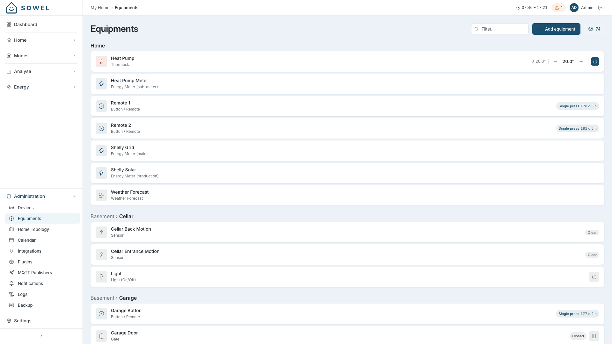

# Equipments

Equipments are the core concept in Sowel. An equipment is a **functional unit** that you interact with daily -- "Living Room Spots", "Bedroom Shutters", "Kitchen Sensor".

**A Device is what's on the network, an Equipment is what's in the room.** You never think about the Zigbee dimmer module installed behind the wall -- you think about your living room lights.

## Creating an equipment

Go to **Administration > Equipments** and click **Add Equipment**.

### Step 1: Basic information

| Field       | Required | Description                                                            |
| ----------- | -------- | ---------------------------------------------------------------------- |
| Type        | Yes      | The equipment category (see [Equipment types](#equipment-types) below) |
| Name        | Yes      | A meaningful name like "Living Room Spots" or "Kitchen Sensor"         |
| Zone        | Yes      | Which room or area this equipment belongs to                           |
| Description | No       | A note for yourself                                                    |

!!! info "Type cannot be changed after creation"
Choose the type carefully -- it determines which devices are compatible and how the equipment is displayed. The one exception: a shutter, an awning and a door can be switched into one another from the equipment's **Edit** form, since they bind the same way (see [Door](#access)).

### Step 2: Select devices

Click **Next: Select devices** to see a list of compatible devices. Sowel filters devices automatically based on the equipment type.

- Select one or more devices
- Click **Create**

**That's it.** Sowel automatically creates all the data and command bindings. Every value the device exposes (temperature, humidity, battery...) becomes immediately available on the equipment.

!!! tip "You can skip device selection"
You can create an equipment without a device and bind one later from the detail page.

### Multi-device binding

A single equipment can bind to **multiple devices**. This is one of Sowel's most powerful features.

**Example:** Three separate IKEA dimmer modules power the spotlights in your living room. Create one "Living Room Spots" equipment and bind all three. A single toggle turns all three on. A single slider dims all three.

---

## Equipment types

Sowel ships a closed catalogue of equipment types. Every equipment in your home is one of these, and the type drives both the UI controls and the expected data shape.

### Lights

| Type                 | Controls                             | Expected data                               |
| -------------------- | ------------------------------------ | ------------------------------------------- |
| **Light (On/Off)**   | Toggle On/Off                        | state (on/off)                              |
| **Light (Dimmable)** | Toggle + brightness slider           | state, brightness                           |
| **Light (Color)**    | Toggle + brightness + color controls | state, brightness, color, color temperature |

### Shutters

| Type        | Controls                                   | Expected data                              |
| ----------- | ------------------------------------------ | ------------------------------------------ |
| **Shutter** | Open / Stop / Close + position display     | position (0% = closed, 100% = open)        |
| **Awning**  | Retract / Stop / Extend + position display | position (0% = retracted, 100% = deployed) |

Awnings share the shutter control surface (same position binding, same OPEN/STOP/CLOSE buttons) but speak the awning vocabulary throughout the UI: _Déployé / Rétracté_ state pills, _Déployer / Rétracter_ button labels, dedicated "Stores bannes" group in the zone view. Mapping: RF-up = retract = position 0, RF-down = deploy = position 100. See the [somfy-rts plugin](https://github.com/mchacher/sowel-plugin-somfy-rts) for an integration example that handles both shutter and awning families against the same Somfy RTS hardware.

### Climate

| Type             | Controls                                              | Expected data                                                                                                          |
| ---------------- | ----------------------------------------------------- | ---------------------------------------------------------------------------------------------------------------------- |
| **Thermostat**   | Temperature display, setpoint − / +, power on/off, mode | core: current temperature, setpoint, run state, power, operating mode; then whatever else the device offers, as extras |
| **Heater**       | Comfort / Eco toggle                                  | relay state (fil pilote: ON = eco, OFF = comfort)                                                                      |
| **Water Heater** | On/Off toggle, optional dedicated Solar toggle        | on/off relay state, optional solar-channel state, optional water temperature (display only), optional power/energy     |

Thermostat covers air conditioning, pellet stoves, and heat pumps. Heater covers individual electric heaters wired through a fil-pilote relay. Water Heater (chauffe-eau / cumulus) is an on/off relay for a hot-water tank: auto-binds the on/off channel (and its power/energy when the relay meters them); a water-temperature probe can be bound optionally and is shown but kept out of the room temperature average. Setpoint control is intentionally out of scope (that would be a thermostat).

A thermostat has a **core** and **extras**. The core is the small set every thermostat shares and every Sowel surface relies on: `temperature`, `setpoint`, `state`, `power`, `operationMode`, plus `outsideTemperature` when the unit carries an outdoor probe. Sowel recognises a device as a thermostat when it can be given a setpoint, whatever the plugin calls the key. Everything else the device offers (a fan speed, an ioniser, a pellet stove's programme and alarm reset, a vendor setting Sowel has never met) is bound too, but as an **extra**: the card leads with the core and lists the extras in a secondary section, one control per bound command (buttons for a choice, a toggle for an on/off, an action button for a one-shot, a stepper for a number) and one chip per reading. Extras vary from one thermostat to the next and never define the type. The operating mode uses a common vocabulary: `auto`, `heat`, `cool`, `dry`, `fan`, and `off` on units whose mode carries the stop.

On a thermostat, the on/off state reported by the device itself is bound under the `state` alias, the same on/off alias relay-style equipments use. This matters on a **submetered** thermostat (a heat pump measured by a clamp): there the `power` alias carries the live wattage, and the wattage cannot tell the UI whether the unit is on or in standby. If your thermostat card never shows as on, open the equipment's missing-bindings panel and add the device's power reading: it is offered as `state`. Legacy thermostats with the boolean bound directly under `power` keep working unchanged.

The setpoint has the same − / + buttons on the equipment page, in the Home rows, on the dashboard and in its phone panel, and so do a thermostat's numeric extras, an EV charger's current and a car's charge limit. The value follows each tap at once and one order leaves after the last one: about 0.6 s later for a cloud device, 0.15 s for a local one. See [Dashboard](dashboard.md#equipment-widget).

A water heater (and a switch) can also carry a dedicated **solar** on/off channel, independent from the main on/off: a second contact (e.g. a SONOFF MINI-ZBD Zigbee dry-contact relay driving the photovoltaic input of a heat-pump water heater). It is bound explicitly under the solar role, distinct from the appliance's normal operation. On a water heater left on permanent mains, only the Solar toggle appears; the card shows one toggle per bound channel. The solar channel is the actuator a solar-surplus recipe drives through the energy arbiter; the arbitration logic itself stays in the recipe.

### Access

| Type     | Controls                            | Expected data                                       |
| -------- | ----------------------------------- | --------------------------------------------------- |
| **Gate** | Open/Close button + state indicator | gate state (open, closed; unknown without a sensor) |

!!! tip "Dashboard icon"
You can choose a specific icon for gates on the dashboard: standard gate, sliding gate, or garage door.

A gate can be driven by any on/off relay — a Zigbee dry-contact module (e.g. SONOFF MINI-ZBD), a LoRa relay channel, or a Somfy RTS remote — and the command button triggers it as a momentary action. Configure the pulse behavior (inching / auto-off) on the device itself. Bind a door contact sensor (e.g. SONOFF SNZB-04P) to the same equipment to get the open/closed state; without one the state shows as unknown.

An administrator can turn on **Confirmation before action** on the gate's equipment page. Every press that would move the gate then asks first — on the Dashboard, in the Home view, in the Equipments list and on the equipment page, with a slide on a touch screen and a dialog with a mouse. See [Gates that ask first](dashboard.md#gate-confirmation).

| Type     | Controls                                                 | Expected data                                                                   |
| -------- | -------------------------------------------------------- | ------------------------------------------------------------------------------- |
| **Door** | Open / Stop / Close + state pill, slider with a position | end state (open, closed, opening, closing, fault) and/or position (0% = closed) |

A **door** is a motorised door that takes explicit Open / Close / Stop orders and reports where it is: a chicken-coop door with limit switches, a garage door driven by its own motor protocol. It binds like a shutter, but it is not one: it has its own « Doors » group in the zone view, its own zone count (« doors 1/2 »), and no « close all shutters » command ever reaches it. A garage door driven by a single impulse on a dry contact stays a **gate**.

The pill reads the door's own word first (Open, Closed, Moving, Fault), and its position when it reports no word. In a zone count, a door is open unless it is proven closed: moving or in fault counts as open, an unknown state does not.

!!! tip "Turning a shutter into a door"
A shutter, an awning and a door can be switched into one another from the equipment's **Edit** form: the type selector offers those three. The equipment keeps its bindings, history, recipes and dashboard tiles. For every other type the selector stays locked. A recipe whose slot only accepts shutters keeps running, but its picker no longer offers the equipment the next time you edit it.

### Sensors

| Type                 | Controls / Display                                                                                     | Expected data                                                                                                                                                                                                                                                       |
| -------------------- | ------------------------------------------------------------------------------------------------------ | ------------------------------------------------------------------------------------------------------------------------------------------------------------------------------------------------------------------------------------------------------------------- |
| **Sensor**           | Read-only multi-value display, auto-adapted                                                            | temperature, humidity, pressure, CO2, VOC, luminosity, noise, battery, motion, contact, water leak, smoke                                                                                                                                                           |
| **Weather Station**  | Multi-value display; a gauge that measures only rain gets a [rain tile](dashboard.md#equipment-widget) | temperature (with today's measured min/max shown underneath), humidity, pressure, rain (1 h and 24 h totals, plus _Rain today_ since midnight when the station reports it; history bars per hour and per day, each day cut at local midnight), wind, noise, battery |
| **Weather Forecast** | Day-by-day forecast cards (J+1 to J+5)                                                                 | weather condition, temperature min/max, rain probability, wind gusts                                                                                                                                                                                                |
| **Button / Remote**  | Not directly controlled (used as trigger)                                                              | action events (single press, double press, long press)                                                                                                                                                                                                              |

The generic **Sensor** type adapts its display automatically. Boolean sensors (motion, contact, water leak, smoke) get appropriate badges; numeric sensors get values with the right unit and icon.

Buttons are inputs only — bind them to a [recipe](recipes.md) action or a [mode](modes.md) toggle through **Administration > Buttons**.

### Energy

| Type                        | Controls / Display                                                 | Expected data                                    | Notes                                                                                                                  |
| --------------------------- | ------------------------------------------------------------------ | ------------------------------------------------ | ---------------------------------------------------------------------------------------------------------------------- |
| **Energy Meter**            | Power (W) and daily energy (Wh/kWh)                                | cumulative energy (Wh)                           | Submeter for a circuit (heat pump, pool, EV charger). Feeds the [by-usage breakdown](energy.md#total-by-usage-toggle). |
| **Main Energy Meter**       | Same + drives the [Energy monitoring](energy.md) page              | power, energy (with HP/HC tariff classification) | One allowed per system.                                                                                                |
| **Energy Production Meter** | Production display + autoconsumption calculation                   | production power, cumulative production          | One allowed per system.                                                                                                |
| **EV Charger**              | Start/stop, vehicle state, power, session energy, charging current | see below                                        | A controllable load and a submeter. Deferrable by default for the [energy arbiter](energy.md).                         |

#### Electric vehicle

An **electric vehicle** is a battery-electric or plug-in hybrid car, read from its maker's cloud. Its card draws the car as its own gauge: the body fills with the battery level (amber while charging, red under 20 %), and a charging post with its cable appears while the car is plugged in. Under it come the battery level, the electric range, the charging state (_Plugged in_, _Waiting for power_, _Charging_…) and, when the car's last report is more than 15 minutes old, how old it is: a sleeping car reports nothing, and an old battery level is not today's. Its detail page adds **Wake up** and **Start charging** buttons and a charge-limit setting when the car supports them, and a small refresh button that reads the car's latest report at once (it does not wake a sleeping car), and shows the charge limit on the battery bar. A click on the card opens that sheet, on desktop as on mobile.

Sowel defines what a car carries, whatever the maker: battery level, range, plugged, charging state, last report time, at home (yes/no, no coordinates), mileage, charge limit, and the wake, start-charging and refresh commands. A car is not an energy meter nor a flexible load: the charger measures and is controlled. Fuel and climate values of a plug-in hybrid stay visible as extras.

#### EV charger

An **EV charger** (borne de recharge) is a charging station for an electric vehicle, portable or wall-mounted. Its card shows whether a car is plugged in (_Unplugged_, _Plugged in_, _Charging_), the live power while it charges and the energy delivered this session; its detail page adds a start/stop toggle and a charging-current stepper bounded by the charger's own range. On mobile, a tap opens the detail sheet: starting a charge is never a single accidental tap. A charger offers no timed command: its charge is driven by a recipe and the energy arbiter.

Sowel defines what a charger carries, whatever the integration: start/stop (`state`), the vehicle state (`vehicle`), live power (`power`), energy history (`energy`), the charging current (`charge_current`), the session energy (`session_energy`), and the measured current and voltage. An integration that reports these provides a charger Sowel recognises on its own; the device picker offers it first. Anything else the charger reports (a status code, a temperature, the last session) stays visible as an extra.

The first supported charger is the dé portable charger, through the [Tuya (local)](https://github.com/mchacher/sowel-plugin-tuya) integration from its version 0.2.0 (earlier versions publish the charger without these categories). Charging from solar surplus or off-peak is a recipe's job, through the energy arbiter; the equipment only exposes and commands.

**A charger that reports nothing** (a wallbox with no connection, for instance) can still be followed through an energy meter on its supply line: a current clamp or a DIN-rail meter that Sowel already reads. Create an EV charger and pick that meter: the device picker lists energy meters after the chargers, marked _metered only_. Such a **metered charger** shows its power and energy, with no start/stop, and its charging sessions are found from its power (below). A clamp measures one phase: on a three-phase charger it sees a third of the energy. Do not enable energy management on it unless the meter also switches the line (a metering relay): otherwise Sowel cannot switch it.

#### Charging sessions and cost per vehicle

Every plug-in on a charger is a **charging session**, from plug-in to unplug: pauses and restarts inside it (solar surplus, clouds, off-peak) stay one session, and a session under 0.1 kWh is not kept. Its energy is what the charger measures, losses included, since that is what you pay. Each 5-minute window is priced at its own tariff (peak or off-peak), and **solar is free**: the car is served last by the sun, so it is charged only what the house had to buy from the grid because of it. The cost is frozen at the prices of the moment; changing your prices later does not change past sessions.

Sowel then works out **which car charged**, from what the cars report through their maker's cloud: plugged in, charging, battery rising, at home. A car that said it was charging or plugged in a few minutes before the session opened counts too, unless another session was in progress at that moment. Sowel waits two hours after the unplug, because a car's cloud often reports late, and decides only when it is sure; otherwise the session stays **To attribute**. Every car known to Sowel is a candidate on every charger.

- **The charger's page** lists its sessions month by month, with the car each one belongs to (_auto_, _corrected_, or _To attribute_ with the reason). Tap a session to choose the car, **Other vehicle** for a guest (counted for no car), or **Attribute later**. Any user can do it, not only an administrator, and the choice is final: Sowel never changes it again.
- **The vehicle's page** has a **Home charging** section: the month's cost and energy, a bar split into grid off-peak, grid peak and solar with the kWh and € of each part, the **cost per 100 km**, and the month's sessions.
- **The charge in progress** also shows on the vehicle's page, above the month, as soon as Sowel knows which car it would attribute it to: the live power while charging; during a pause, since when and why (charger switched off, the car's charge limit reached, or waiting for the car); after the unplug, the time it will be attributed, with a **That's …** button to attribute it now. It counts in the month only once attributed.

- **A metered charger** does not say when a car is plugged in, so its session starts when its power reaches 500 W and ends after 30 minutes under 500 W, dated at its last active minute; a pause under 30 minutes stays in the session. The rest is the same: cost, solar share, attribution, card on the car (without the reason of a pause).
- **Two chargers.** A car charges on one charger at a time: a car Sowel gives to a session on one charger is not a candidate for a session at the same time on another. And a charger can name a **usual vehicle** (on its page, for an administrator): when several cars could have charged during one of its sessions, the session goes to it (_usual vehicle_). It never takes a session no car claims, such as a guest's.
- **Two cars charging at once** on two chargers report to both sessions. Sowel tells them apart by what is measured: the power each car says it charges at, compared with each charger's (when its integration reports it), then the energy each car's battery took, compared with each session's energy (once Sowel has learned each car's energy per battery point). The list then reads _auto · power_ or _auto · energy_. When nothing separates them clearly, both stay to attribute. The usual vehicle is only for a charger that always serves the same car.
- **When Sowel guesses, it says so.** A session given by a usual vehicle reads _usual vehicle_, and so does the session on the other charger that it decided. A car Sowel last saw away from home must be seen home again before it can take a session. When two cars charge at once, they share the house's grid import and its solar.

The cost per 100 km is the price you paid per kWh at home, times the car's consumption, which Sowel measures itself: how much battery the car uses per km while driving, and how many kWh one battery point takes, learned from your home charges. Charging elsewhere (at work, on the motorway) does not distort it: a drive during which the battery rose is left out. It appears after a first home charge of at least 10 % and 50 measured km in the month. For a **plug-in hybrid** (a switch on its page, for an administrator), it is not shown: part of its km run on fuel.

Sessions start when this feature is installed: earlier months are not rebuilt. Energy → By usage still shows the charger with the month's average price, so its € there differs from the sum of its sessions.

### Media

| Type             | Controls                                 | Expected data                                                |
| ---------------- | ---------------------------------------- | ------------------------------------------------------------ |
| **Media Player** | Power on/off, volume, mute, input source | power state, volume level, mute, current input, picture mode |

### Appliances

| Type          | Controls / Display       | Expected data                                                                                                 |
| ------------- | ------------------------ | ------------------------------------------------------------------------------------------------------------- |
| **Appliance** | Read-only status display | power state, operating state (ready/running/paused), current phase, progress (%), remaining time, energy used |

!!! tip "End-of-cycle notification"
Use a `state-watch` recipe to get notified when the operating state changes from `running` to `ready`.

### Water

| Type            | Controls                                                                 | Expected data                                                                    |
| --------------- | ------------------------------------------------------------------------ | -------------------------------------------------------------------------------- |
| **Water Valve** | Toggle On/Off, "Water for X min" timed action (firmware-side auto-close) | state, flow rate (m³/h), battery, device status (normal / water shortage / leak) |

Designed for devices like the SONOFF SWV. Standard aliases: `state`, `flow`, `battery`, `status`, `duration`, `cycles`, `interval`, `capacity`, `autoCloseOnShortage`. Only `state` is required — the UI adapts to whichever are bound. Zones aggregate open/total valves and sum live flow across the tree.

### Pool

| Type               | Controls                               | Expected data                                   |
| ------------------ | -------------------------------------- | ----------------------------------------------- |
| **Pool Pump**      | Toggle On/Off + daily runtime display  | pump state, daily runtime                       |
| **Pool Cover**     | Open / Stop / Close + position display | cover position (0% = closed, 100% = open)       |
| **Pool Heat Pump** | Power on/off, target water temperature | water temperature, target setpoint, power state |

Pool equipments work with the **Pool Pump Schedule** recipe (daily runtime tied to water temperature) and feed the pool widgets on the dashboard.

### Cameras

| Type       | Controls                                                          | Expected data                                                            |
| ---------- | ----------------------------------------------------------------- | ------------------------------------------------------------------------ |
| **Camera** | Live view, snapshot refresh, monitoring on/off, spot light, siren | snapshot, live stream, monitoring state, spot light mode, last detection |

The **Camera** type is vendor-agnostic — any camera plugin that reports the
right data can bind to it. None of these are required; the detail page only
shows the controls the bound camera actually offers.

!!! tip "Every feature is opt-in, per camera"
Whether a given camera shows a live stream, lets you toggle monitoring, or reports detections is entirely down to which data/orders you bind to it — the same binding mechanism used by every other equipment type. Creating a camera from a discovered device auto-binds the snapshot, live stream and monitoring toggle; the spot light control, siren, and detection events are opt-in — add them later from the equipment's detail page ("Add binding") if you want them. A feature you don't bind is unreachable even via the API, not just hidden — this is a deliberate privacy control, not only a display preference.

Live view and snapshots are proxied through Sowel's backend — your browser
never talks to the camera directly, and never learns its network address.

### Other

| Type              | Controls                    | Expected data                         |
| ----------------- | --------------------------- | ------------------------------------- |
| **Switch / Plug** | Toggle On/Off + state badge | state (on/off); optional power/energy |

A **metering plug** (e.g. SONOFF S60ZBTPF) is a `Switch / Plug` that also
reports `power`/`energy`. Bind it as a switch and Sowel automatically captures
the metering: the card shows live power next to the toggle, the consumption
feeds the energy dashboard (history, HP/HC), and the plug appears in the live
submeter breakdown — while keeping its ON/OFF control. A basic relay with no
metering data behaves as a plain switch.

---

## Managing equipments

### Detail page

Click on any equipment to see its detail page. It puts what you use first and what you set up last:

- **Use** -- the header names the type and the room (« Thermostat · Living room »), then the controls adapted to the equipment type (value, setpoint, mode, buttons), the timed command when one is set, the charging sessions of a car or a charger, and the **history chart**, opened on the main series over the last 24 hours (temperature for a thermostat, power for a charger, position for a shutter, battery level for a car). Fine settings stay folded: a thermostat's **Other settings** (remembered open or closed per equipment), a charger's raw **Charger details**. Pick another series or range in the chart as before.
- **Energy** -- on a meter or a metered equipment, one card with the energy cumuls and the live electrical measures.
- **Configuration** (administrators) -- one card at the bottom. Each setting is a folded row with where it stands (« Timed command · Disabled »): confirmation before action, order outcome, shared access, timed command, invert direction, already counted by, energy management, button actions, then the devices, history and bindings. A **?** next to a setting explains it. **Delete equipment** sits at the foot of this card; **Edit** stays in the header.

The **back** link returns to where you came from: the room, the dashboard, a mode, the equipment list. Opened from a direct link, it goes to the equipment's room (« Back to Living room »). The sidebar and the breadcrumb follow the same rule: the page sits under **Maison › room**, and under Administration only when you opened it from the equipment or device list.

The page loads the equipment once, then follows its live values without asking the server again. Only that first load, or a **Retry**, can fail. If the server is busy or cannot be reached at that moment, the page says so (« Server busy », « Cannot connect ») and offers **Retry**, unless Sowel already has the equipment in hand: the page then shows it and keeps it live, with no message. « Equipment not found » means the equipment really does not exist.

### Changing the device

From the detail page, click **Change device** to rebind the equipment to different devices. Sowel removes all existing bindings and recreates them automatically from the new device(s).

!!! warning
This rebuilds the bindings from scratch, so custom aliases and per-binding
historization settings are lost. To pick up new values without losing them,
use **Add missing bindings** below.

### Adding missing bindings

A plugin update can start publishing values a device did not report before. Those values reach the device, but an equipment bound before they existed does not pick them up on its own.

Open **Configuration > Bindings** on the detail page. When something is missing, Sowel says so and offers **Review**:

- every missing value is listed, checked by default
- uncheck anything you do not want, then confirm
- values that would be recorded in history are marked, and the total is shown before you confirm

Nothing is added until you confirm, so a value you removed on purpose only comes back if you ask for it. On a multi-channel device, only the channel this equipment already uses is offered.

### Historization

Each data value is historized to InfluxDB by default based on its category (temperature, humidity, power...). From the detail page, you can override this per binding:

| Setting       | Effect                      |
| ------------- | --------------------------- |
| **Default**   | Follows the category rule   |
| **Force ON**  | Always historize this value |
| **Force OFF** | Never historize this value  |

### Timed command

An equipment can be told to act now and undo it after a delay: open the gate for a quarter of an hour, run the outside light for half an hour, water for twenty minutes. The engine holds the deadline, so a restart or a power cut does not lose it, and a deadline that passed while Sowel was down is honoured when it comes back.

Enable it from the equipment page, under **Timed command**. It is off by default. You choose the command, the command that undoes it, and the duration. On a sliding gate driven by a single impulse, the two commands are the same one and the panel says so.

The panel appears only on an equipment that reports a state for that command. Without one, ending the window by hand would go unnoticed and the deadline would act on an equipment that has moved since, which on an impulse gate means re-opening what you just closed.

Once enabled, the command shows up in two places:

- On the **Home** view, next to the equipment on its row, with the remaining time while a window is open.
- On the **Dashboard**, as a tile you pin beside the ordinary one, so "open" and "open for fifteen minutes" stay two different buttons.

Pressing the tile again while the window is open gives it more time rather than acting twice. Cancelling sends the closing command straight away.

#### Steps: each press asks for longer

One duration answers "not yet" but never "how much longer". Tick **Steps** under the timed command and pick the lengths a press walks through — a quarter of an hour, half, a full one, say. Then:

- the **first press** acts and starts the shortest length;
- **each further press** moves to the next length, counted from that moment, and sends nothing;
- a **press past the last one** stops the countdown and leaves the equipment exactly as it is — the gate stays open, and nothing will close it.

That last press is deliberately not the same thing as cancelling: cancelling sends the closing command, stopping the countdown does not. Both are on the tile, side by side.

Two to six steps, shortest first. The first one is the duration, so the duration selector follows it rather than claiming a length of its own. Editing the steps while a window is running does not disturb it: the window keeps its own deadline and the next press picks up from the nearest step.

!!! warning "A contact that only certifies one direction"
A gate's contact usually proves it is closed and only suggests it is open. If you close the gate by hand without the contact seeing it, the window keeps running and will re-open the gate at the deadline. End the window from Sowel rather than by hand when that matters.

### Order outcome { #order-outcome }

For two kinds of order, Sowel reads what the device reports afterwards to tell whether the order
moved something, and says so in one line under the tile's name (desktop, phone and timed tile) and
on the equipment page. It is on by default for a **gate** and a **door**, off for a shutter or an
awning; an admin switches it per equipment on the equipment page (« Follow order outcomes »).

- **A gate impulse** — an order whose value is `pulse` on a gate — when the gate's state is known
  (its position sensor, `closed`, or its `state`). From closed, the gate must open within 15 s;
  from open, it must close within 60 s (a pulse on an open gate may stop or reverse it before it
  closes). Any other value sent to a gate is left as before.
- **A door's Open or Close** (or a shutter's or awning's, once switched on), when its state speaks
  the end-state words — it has reported `CLOSED`, `OPENING`, `CLOSING` or `FAULT` at least once
  since Sowel started, as the LoRa coop door does. It must reach `OPEN` / `CLOSED` (or position
  100 / 0) within 60 s. A cover that only echoes `OPEN` / `CLOSE`, as most Zigbee covers do, stays
  silent even when switched on.

| The line reads                                            | When                                                                        |
| --------------------------------------------------------- | --------------------------------------------------------------------------- |
| « Sent… »                                                 | the order was sent, the window is running                                   |
| « Moving… »                                               | the door reports it is travelling toward the target                         |
| « ✓ Opening confirmed » / « ✓ Closing confirmed »         | the expected state was reported (gone after 4 s)                            |
| « Fault: bottom contact » / « Fault: wiring » / « Fault » | the device reported `FAULT` (its `why` gives the reason; `NONE` gives none) |
| « No movement: command lost or gate blocked »             | a gate impulse from closed saw nothing within 15 s                          |
| « Still open: command lost or gate stopped on the way »   | a gate impulse from open did not see the gate close in 60 s                 |
| « No confirmation »                                       | a door order did not reach its end state within 60 s                        |
| « Stopped »                                               | someone stopped the door on the way (`STOP`)                                |

A fault or a missing confirmation also raises an alarm, pushed like the other alarms, and it clears
itself when the expected state finally arrives, even late. The alarm says what the gate or door
did (« Portail: still open after the command — lost or stopped on the way », « Coop door: fault
(bottom contact) »): in your language in the banner and the activity feed, and in the push in the
language of the user who turned push on (their **Language** preference). Telegram gets it in
English. A stopped door (`STOP`) raises no alarm.

**A gate impulse is never resent**: a second impulse would reverse the gate. A door's Open or Close
is absolute, so it is resent once if it was lost while the device or its integration was offline,
as any other order (not after a fault: the door answered). A second impulse whose gate
state Sowel cannot read yet (the state reads unknown until the next report) does not cancel the
first one's follow-up: the first one's outcome still comes. An order that could not be sent at all
(integration offline) shows no line: the error came back when it was given. The state cannot tell
a lost command from one the motor could not carry out, so both read the same. The line is live: a
reload shows nothing until the next order.

### Disabling an equipment

A disabled equipment behaves as if it weren't there for the engine, while staying visible in the admin UI:

| Where                        | Disabled equipment         |
| ---------------------------- | -------------------------- |
| Home view                    | Hidden                     |
| [Zone aggregation](zones.md) | Excluded                   |
| Recipes                      | Not triggered              |
| Mode impacts                 | Skipped                    |
| Administration > Equipments  | Still visible and editable |

### Deleting an equipment

**Delete equipment** is at the foot of the **Configuration** card of the detail page. Deleting removes the equipment from Sowel. The underlying devices are **not** affected -- they remain available for new equipments.

!!! warning
Deleting an equipment also removes any recipe instances and mode impacts that reference it.
